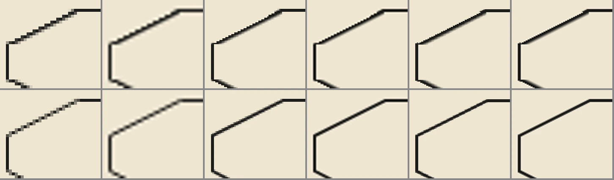

# Overnight, 16 November: what is live on staging

Staging: https://the-guild-hotel-c34e71.webflow.io (now on release v1.2.31). Everything below was checked on the live staging site with screenshots on each ticket.

## Ready for you to check

**Arts and Gallery (card 2).** Back in a chained modal now works: on [Arts](https://the-guild-hotel-c34e71.webflow.io/arts), open "Oceano", tap "by Eva Struble", then Back returns you to the artwork, not the grid. Escape does the same. Only Oceano has an artwork modal at the moment. [#178](https://github.com/Granite-Marketing/guild-hotel-webflow/issues/178)

**Press (card 5).** [Press](https://the-guild-hotel-c34e71.webflow.io/press) is one list alternating left and right without breaks, with one heading each for Press, Design and Community, and tabs built from the CMS. The first tab click after loading used to stop short; it now lands on its heading every time. [#181](https://github.com/Granite-Marketing/guild-hotel-webflow/issues/181)

**Buttons (card 6).** The new hexagon buttons are live on every page and switch correctly at rest and on hover. After your note that the corners looked broken up when zoomed, the outline is now drawn as a proper vector shape inside each button, so the angled corners are as sharp and even as the straight edges, and no edge goes thin. Best seen on a retina screen: "Discover more" on [Dining](https://the-guild-hotel-c34e71.webflow.io/dining), the guest options on [Rooms](https://the-guild-hotel-c34e71.webflow.io/rooms), "Book your space" on [Meetings](https://the-guild-hotel-c34e71.webflow.io/meetings). [#190](https://github.com/Granite-Marketing/guild-hotel-webflow/issues/190)

**Paragraphs (card 4).** Omar chose 16px, so body text on desktop is now 16px on every page, while the text over the hero image at the top of each page stays at 18px as he asked. Phones and tablets were already 16px and are unchanged. [#182](https://github.com/Granite-Marketing/guild-hotel-webflow/issues/182)

**History (card 7).** On [History](https://the-guild-hotel-c34e71.webflow.io/history) the George Marston stamp now appears the moment it enters the screen, "Once opened, never closed" waits until it is just above the middle of the screen, and the timeline photos open upward with the mask reveal. [#189](https://github.com/Granite-Marketing/guild-hotel-webflow/issues/189)

**Corporate, Meetings and Neighborhood maps, and page loading (cards 8 and 9).** Pages scroll from your first touch while still loading, never jump back up, the hero text plays once, and scrolling over the map no longer pauses. Try [Corporate](https://the-guild-hotel-c34e71.webflow.io/legal-corporate/corporate), [Neighborhood](https://the-guild-hotel-c34e71.webflow.io/neighborhood) and [Meetings](https://the-guild-hotel-c34e71.webflow.io/meetings). [#176](https://github.com/Granite-Marketing/guild-hotel-webflow/issues/176)

**Neighborhood and Happenings hover (cards 10 and 11).** The "Beyond Downtown" images on [Neighborhood](https://the-guild-hotel-c34e71.webflow.io/neighborhood) and the "More around town" cards on a [Happenings story](https://the-guild-hotel-c34e71.webflow.io/happenings-stories/locals-night-at-rodeo-bar) zoom very slightly (1.04) on hover. [#185](https://github.com/Granite-Marketing/guild-hotel-webflow/issues/185)

## Assumptions I made

1. **History photo mosaic.** The photo grid lower on History ("Discover the Property" area) no longer animates; it is simply there. You said it did not need an animation. The same block is on Meetings, Corporate, Neighborhood and the Dining pages, so it is static there too.

2. **Buttons: no SVG needed from the client.** I tested whether a better SVG file would help. It would not: the softness came from how the browser drew the outline, not from the shape. The fix needed no change in Webflow.
3. **Buttons: what stays.** On a normal (non-retina) screen, the long shallow corners on the widest buttons still show tiny steps, which every screen does with a thin angled line. If you want them cleaner, the option is shorter, fixed-size corners on wide buttons; I left the design as it is.
4. **Buttons: Safari.** I could only test in Chrome tonight. Please glance at a button in Safari.
5. **Paragraphs: what counts as a hero.** Only the text over the big image at the top of each page stays at 18px. The text on the full-width venue photos further down (Dining, Wellness, Meetings) went to 16px like other body text. Small capital headings above sections keep their size.
6. **Paragraphs: test page kept.** The History 16px test page is still on staging, hidden from search. I'll delete it once you say so.

## Left alone, as agreed

- Filter menu shape: still waiting on the client's SVG ([#191](https://github.com/Granite-Marketing/guild-hotel-webflow/issues/191)).
- Reveal audit: parked ([#192](https://github.com/Granite-Marketing/guild-hotel-webflow/issues/192)).
- Meetings form questions: waiting on Omar.
- Review leftovers from the code build ([#206](https://github.com/Granite-Marketing/guild-hotel-webflow/issues/206)), not started: going back to an earlier modal does not restore its dim background setting or its scroll position; the map loader uses a timing check the house rules discourage; the button outline formula only holds at a 1px thickness; one table row in the button notes is out of date; one accessibility flag is not updated after a back link; some modal back-link paths have no automated test; late text splitting has no check that it leaves page height unchanged.

## Also done

- The modal test now matches the new Back behaviour and runs offline without errors ([#198](https://github.com/Granite-Marketing/guild-hotel-webflow/issues/198)).
- Release ticket closed ([#187](https://github.com/Granite-Marketing/guild-hotel-webflow/issues/187)).
