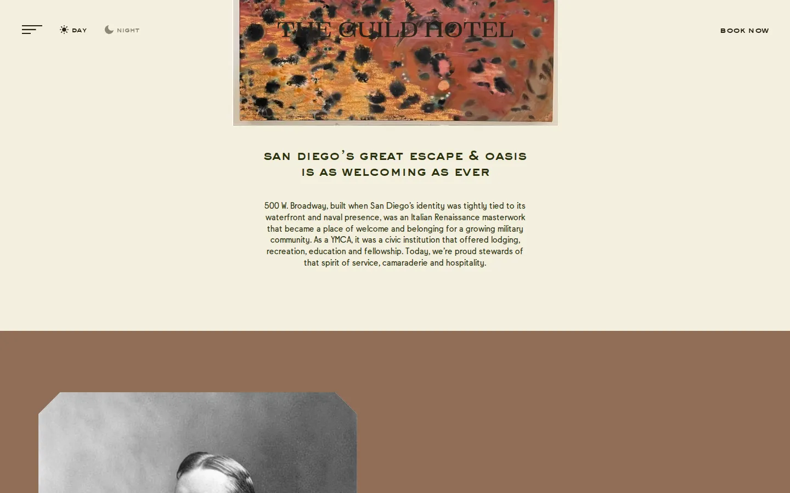
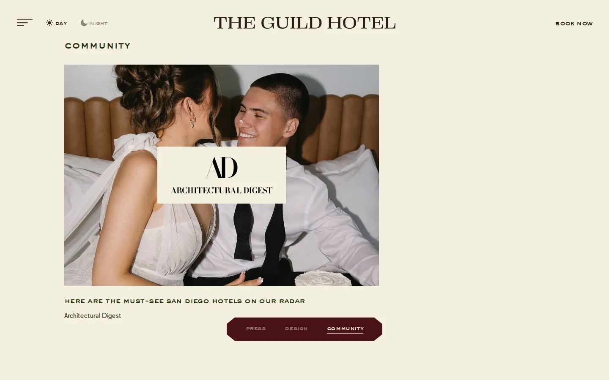
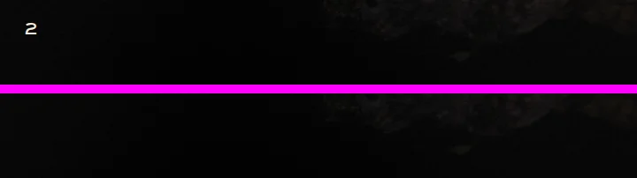

# Overnight, 16 November: what is live on staging

Staging: https://the-guild-hotel-c34e71.webflow.io (now on release v1.2.35). Everything below was checked on the live staging site with screenshots on each ticket.

## Ready for you to check

**Arts and Gallery (card 2).** Back in a chained modal now works: on [Arts](https://the-guild-hotel-c34e71.webflow.io/arts), open "Oceano", tap "by Eva Struble", then Back returns you to the artwork, not the grid. Escape does the same. Only Oceano has an artwork modal at the moment. [#178](https://github.com/Granite-Marketing/guild-hotel-webflow/issues/178)

**Press (card 5).** [Press](https://the-guild-hotel-c34e71.webflow.io/press) is one list alternating left and right without breaks, with one heading each for Press, Design and Community, and tabs built from the CMS. The first tab click after loading used to stop short; it now lands on its heading every time. [#181](https://github.com/Granite-Marketing/guild-hotel-webflow/issues/181)

**Buttons (card 6).** The new hexagon buttons are live on every page and switch correctly at rest and on hover. After your note that the corners looked broken up when zoomed, the outline is now drawn as a proper vector shape inside each button, so the angled corners are as sharp and even as the straight edges, and no edge goes thin. Best seen on a retina screen: "Discover more" on [Dining](https://the-guild-hotel-c34e71.webflow.io/dining), the guest options on [Rooms](https://the-guild-hotel-c34e71.webflow.io/rooms), "Book your space" on [Meetings](https://the-guild-hotel-c34e71.webflow.io/meetings). [#190](https://github.com/Granite-Marketing/guild-hotel-webflow/issues/190)

**Paragraphs (card 4).** Omar chose 16px, so body text on desktop is now 16px on every page, while the text over the hero image at the top of each page stays at 18px as he asked. Phones and tablets were already 16px and are unchanged. [#182](https://github.com/Granite-Marketing/guild-hotel-webflow/issues/182)

**History (card 7).** On [History](https://the-guild-hotel-c34e71.webflow.io/history) the George Marston stamp now appears the moment it enters the screen, "Once opened, never closed" waits until it is just above the middle of the screen, and the timeline photos open upward with the mask reveal. [#189](https://github.com/Granite-Marketing/guild-hotel-webflow/issues/189)

**Corporate, Meetings and Neighborhood maps, and page loading (cards 8 and 9).** Pages scroll from your first touch while still loading, never jump back up, the hero text plays once, and scrolling over the map no longer pauses. Try [Corporate](https://the-guild-hotel-c34e71.webflow.io/legal-corporate/corporate), [Neighborhood](https://the-guild-hotel-c34e71.webflow.io/neighborhood) and [Meetings](https://the-guild-hotel-c34e71.webflow.io/meetings). [#176](https://github.com/Granite-Marketing/guild-hotel-webflow/issues/176)

**Neighborhood and Happenings hover (cards 10 and 11).** The "Beyond Downtown" images on [Neighborhood](https://the-guild-hotel-c34e71.webflow.io/neighborhood) and the "More around town" cards on a [Happenings story](https://the-guild-hotel-c34e71.webflow.io/happenings-stories/locals-night-at-rodeo-bar) zoom very slightly (1.04) on hover. [#185](https://github.com/Granite-Marketing/guild-hotel-webflow/issues/185)

## Morning fixes, 17 November (from your review)

**Meetings venue slider.** Each venue now holds while you scroll at a normal pace: Council Boardroom holds for about two screens of scrolling after the image opens (it was under one), and every later venue for just over one. The same slider on Home, Dining, Wellness and Corporate got the same timing.

**Arts full-screen image.** Once the image fills the screen it now holds for more than a screen of scrolling (it was half), so it no longer passes in a blink. Every section built the same way uses this new default.

**Photo grid text.** The photos stay still, and the captions and the title on the grid now rise in line by line as they scroll in, on every page that has the block. On History this also needed a timing fix, because the pinned section above it made its text play before you reached it.

**Press tab bar.** The Press / Design / Community bar now stays visible through the whole Community section and only fades as the contact form comes into view. Blog and Happenings work the same way.

**History dates.** The 1924 and 2026 labels now animate in at the same moment as "Once opened, never closed".

**Test page.** The History 16px test page is off staging (its address now shows "page not found"). Webflow's tools can only hide a page, so it still sits as a draft in the Designer; delete it there whenever convenient.

You confirmed: hexagon corners stay as they are, and hero text stays 18px only over the top photo. You also confirmed the Arts, Press and History dates fixes.

## Second round, 17 November

**Scroll mask sections.** In every section where the image grows to full screen and then steps through panels, the old panel's text now finishes sliding out before the new panel's text starts, so two texts never move at once and the new one is always the one you see. This is one global rule for all of them: Home (both), Dining, Wellness, Meetings, Corporate and Arts. The Offers & Packages slider stays as it is, since the client has not flagged it. In a fast-scroll test on Meetings the old version had 33 frames with both texts moving; the new one has none.

**Photo grid numbers.** The small numbers before each caption now stay hidden and rise in with their caption. They had been showing on their own while the caption was still hidden. Top: before. Bottom: now, the same moment, with nothing showing yet.

## Assumptions I made

1. **History photo mosaic.** The photo grid lower on History ("Discover the Property" area) no longer animates; it is simply there. You said it did not need an animation. The same block is on Meetings, Corporate, Neighborhood and the Dining pages, so it is static there too.

2. **Buttons: no SVG needed from the client.** I tested whether a better SVG file would help. It would not: the softness came from how the browser drew the outline, not from the shape. The fix needed no change in Webflow.
3. **Buttons: what stays.** On a normal (non-retina) screen, the long shallow corners on the widest buttons still show tiny steps, which every screen does with a thin angled line. You confirmed the design stays as it is.
4. **Buttons: Safari.** I could only test in Chrome tonight. Please glance at a button in Safari.
5. **Paragraphs: what counts as a hero.** Only the text over the big image at the top of each page stays at 18px. The text on the full-width venue photos further down (Dining, Wellness, Meetings) went to 16px like other body text. Small capital headings above sections keep their size.
6. **Slider sections are longer.** Holding each venue longer makes these sections about half as long again to scroll through (Home's two sections the most). I judged that the right trade for not skipping venues.
7. **Press tab bar fade.** It fades over a quarter screen once the contact form appears, so for a moment it sits just below the last Community card as it fades.

## Left alone, as agreed

- Filter menu shape: still waiting on the client's SVG ([#191](https://github.com/Granite-Marketing/guild-hotel-webflow/issues/191)).
- Reveal audit: parked ([#192](https://github.com/Granite-Marketing/guild-hotel-webflow/issues/192)).
- Meetings form questions: waiting on Omar.
- Review leftovers from the code build ([#206](https://github.com/Granite-Marketing/guild-hotel-webflow/issues/206)), not started: going back to an earlier modal does not restore its dim background setting or its scroll position; the map loader uses a timing check the house rules discourage; the button outline formula only holds at a 1px thickness; one table row in the button notes is out of date; one accessibility flag is not updated after a back link; some modal back-link paths have no automated test; late text splitting has no check that it leaves page height unchanged.

## Also done

- The modal test now matches the new Back behaviour and runs offline without errors ([#198](https://github.com/Granite-Marketing/guild-hotel-webflow/issues/198)).
- Release ticket closed ([#187](https://github.com/Granite-Marketing/guild-hotel-webflow/issues/187)).
