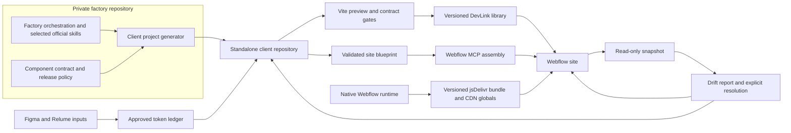
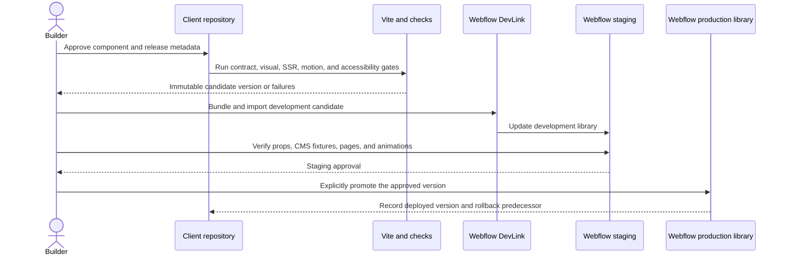
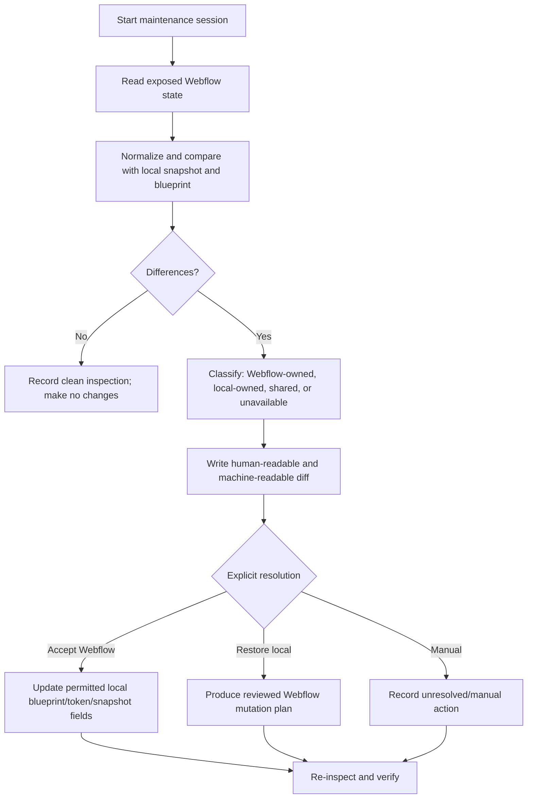

# React DevLink Private Webflow Factory - Plan

## Goal Capsule

Turn this repository into a private, hybrid Webflow factory that can generate client-owned React code-component repositories, import their component libraries through Webflow DevLink, and assemble Webflow pages through MCP without exposing Granite's prompts, skills, orchestration, or cross-client methods.

The user-approved session decisions are authoritative. Current official Webflow code-component and CLI documentation outranks copied skill text when versions or commands conflict. Existing repository conventions remain authoritative for the native Webflow runtime unless this plan explicitly separates or replaces them.

Stop implementation if Webflow's current APIs cannot support a required read-only snapshot or page-assembly action. Report the unsupported surface instead of silently substituting direct Designer element construction or claiming bidirectional source synchronization.

Execution profile: implement in dependency order, preserve user-owned work in the dirty tree, and finish with a generated-project smoke test against a disposable Webflow development library. The executor owns validation and documentation, but not a Granite Next pilot site or production publication.

## Product Contract

### Summary

The repository will support two explicit delivery lanes: the existing native Webflow/CDN runtime and a new React code-component lane. The private factory will generate a complete client repository, enforce Granite's component contract, stage code components through DevLink, assemble pages through MCP from a site blueprint, and report drift before any reconciliation.

### Problem Frame

The current workflow asks the Webflow MCP to construct native elements directly from written design philosophy. That is useful for Webflow-native work but produces inconsistent structure and visual accuracy when recreating detailed Figma or Relume designs. React offers a locally previewable, testable representation before anything enters Webflow, while code components provide curated props that editors can change in the Designer.

The new lane must not create a maintenance trap. A future developer needs the project source, animation code, configuration, release instructions, and content-editing guidance. They do not need Granite's private agent instructions or factory automation. Webflow may also change after handoff, so maintenance sessions must distinguish readable Webflow state from local React source and must never pretend that an imported bundle can be reverse-engineered into its original component source.

### Actors

- **Granite builder:** generates projects, builds components, approves design adaptations, assembles pages, and releases library versions.
- **Content editor:** edits CMS content and exposed component props in Webflow without MCP or local tooling.
- **Client developer:** receives the generated repository and can install, preview, change, bundle, import, and roll back the project's code components.
- **Factory agent:** uses private skills and MCP actions to inspect, validate, report, and assemble within explicit approval boundaries.

### Requirements

#### Architecture and ownership

- **R1 — Hybrid lanes:** Preserve the existing native Webflow runtime and add a separate React code-component lane with unambiguous routing and dependency rules.
- **R2 — Private factory boundary:** Keep agent skills, prompts, orchestration, reusable heuristics, and cross-client knowledge in this private repository only.
- **R3 — Complete client handoff:** Generate a standalone client repository containing all project-specific React source, animations, configuration, fixtures, release metadata, rollback information, and maintenance guidance.

#### Component and design quality

- **R4 — Local visual confidence:** Provide a Vite preview that exercises every component's meaningful variants, long/empty content, animation states, and exact Webflow breakpoint behavior before DevLink import.
- **R5 — Component contract:** Enforce semantic HTML, heading hierarchy, accessibility, keyboard/focus behavior, responsive composition, stable IDs, curated props, CMS-bindable types, animation cleanup, reduced motion, SSR safety, and consistent file boundaries.
- **R6 — Style guide first:** Treat a Figma-derived style guide and approved Webflow variables as the first project deliverable and a gate before page components or assembly.
- **R7 — Intentional token adaptation:** Record the Figma value, approved Webflow value, breakpoint values, reason, date, and author for each deliberate design override; generate local styling adapters from that approved map.

#### Webflow assembly and editing

- **R8 — Blueprint-driven assembly:** Store pages, SEO, component placement, component props, and literal-versus-CMS bindings in a validated client-owned site blueprint that MCP can apply idempotently where supported and report as explicit manual actions otherwise.
- **R9 — Editor-safe controls:** Expose content, slots, variants, site variables, and limited numeric controls in Webflow; avoid arbitrary CSS text props except for documented exceptional components.
- **R10 — Animation ownership:** Never create Webflow Interactions. Use local `gsap` and `@gsap/react` inside React components, while retaining CDN globals and the pnpm-built bundle for the native runtime.

#### Maintenance, release, and safety

- **R11 — Drift before mutation:** Start maintenance sessions with a read-only Webflow inspection, produce a structured diff, and require an explicit resolution before local or Webflow state changes.
- **R12 — Honest synchronization boundary:** Compare pages, variables, component instances/props, CMS/schema, SEO, and scripts where APIs expose them; never claim to pull imported React internals back from Webflow.
- **R13 — Controlled release:** Use explicit versioned development, staging, production, and rollback stages. Production must never follow an unpinned latest build automatically.
- **R14 — Official safeguards:** Pin selected official Webflow skills in the factory, run them through a compatibility policy, and exclude them from generated client repositories.
- **R15 — Existing-work safety:** Preserve the current uncommitted solution notes and assess the partial generator/template as unvalidated input that may be revised or replaced.

### Key Flows

- **F1 — Initialize a client project:** The Granite builder runs the factory generator, receives a clean standalone repository with pinned tooling, completes project metadata, and verifies that no private factory material crossed the boundary.
- **F2 — Establish the style guide:** The factory reads Figma tokens, maps them to Webflow variables, records intentional adaptations, generates the local Tailwind/token adapter, and blocks component work until the style-guide acceptance fixture passes.
- **F3 — Build and preview a component:** The builder creates a section-level React component, declares curated Webflow props, reviews all fixtures in Vite, and passes the component contract before bundling.
- **F4 — Import and assemble:** DevLink bundles/imports a development library; MCP validates the blueprint, creates or updates pages and SEO, places imported component instances, and binds props or CMS fields without silently rebuilding native DOM.
- **F5 — Maintain after Webflow edits:** The factory reads the latest exposed Webflow state, compares it with the client repository snapshot, reports each difference and its owner, then applies only explicitly approved resolutions.
- **F6 — Release and hand off:** A reviewed library version moves through development and staging to an explicit production update; the client receives source, documentation, release metadata, and a tested rollback path.

### Acceptance Examples

- **AE1 — Client-safe generation:** Given a fresh destination, generation succeeds with a valid package name and lockfile; scanning the result finds no `.claude`, `.agents`, private prompts, factory scripts, or parent git history.
- **AE2 — Invalid project input:** Given an empty or unsafe destination/name, generation fails before creating a partial repository and explains the correction required.
- **AE3 — Approved design adaptation:** Given a Figma display heading of `5rem` and an approved Webflow value of `4.5rem`, the token ledger records both values and provenance; the generated Webflow mapping, Vite preview, and Tailwind semantic utility resolve to `4.5rem` until a new approval changes it.
- **AE4 — Duplicate component instances:** Given two instances of the same section on one page, their accessible label relationships use unique IDs and both remain valid.
- **AE5 — Reduced motion:** Given reduced-motion preference, a GSAP component renders its final readable state without scrubbed or entrance motion and cleans up its animation context on unmount.
- **AE6 — Existing Webflow page drift:** Given a page order or prop changed in Webflow, session initialization writes a diff report and performs no reconciliation until the builder chooses Webflow, local, or manual resolution.
- **AE7 — React-source limitation:** Given a Webflow library containing an imported code component, the drift report compares the exposed instance and prop state but marks component implementation as local-only, not recoverable from Webflow.
- **AE8 — Release safety:** Given an uncommitted source tree, failed contract check, or changed component glob that would remove components, production import is blocked and the report identifies the failed gate.
- **AE9 — Editor without MCP:** Given a content editor in Webflow, exposed text, media, variant, and CMS-bound values remain editable; internal markup, arbitrary typography values, and animation implementation remain controlled by source.
- **AE10 — Native runtime regression:** Given an existing project using the native lane, its CDN-loaded GSAP globals and versioned jsDelivr bundle continue to build and run without acquiring the React lane's runtime dependencies.

### Success Criteria

- A newly generated client repository installs reproducibly on the documented Node version and passes its full local release check.
- At least one representative section imports into a disposable Webflow development library, can be placed on a page, and exposes the declared props in Designer.
- The same representative section renders consistently in Vite and Webflow at the canonical breakpoints, including reduced motion and duplicate instances.
- Blueprint validation and dry-run assembly produce deterministic output; rerunning an unchanged blueprint reports no mutations.
- A synthetic Webflow edit produces a non-empty drift report and zero automatic changes.
- Automated boundary tests prove generated projects exclude private factory material.
- The native runtime's existing type/build path remains green.

### Scope Boundaries

#### Included

- Refactoring this repository into a private hybrid factory.
- Hardening or replacing the existing partial `scripts/factory/` and `templates/code-component-project/` work.
- Factory-only selected official Webflow skills and compatibility metadata.
- A client-safe Vite/React/DevLink template, component contract, design-token adapter, blueprint, drift report, release workflow, and handoff guide.
- MCP orchestration for page, SEO, CMS/prop binding, and imported component placement where current tools support those actions.

#### Deferred to Follow-Up Work

- Building Granite Next components or using Granite Next as the first client pilot.
- Adopting the official `site-audit`, `link-checker`, `asset-audit`, `cms-best-practices`, `cms-collection-setup`, `bulk-cms-update`, or `review-comments` skills. Keep these in a documented “useful later” reference list.
- Re-evaluating official `component-scaffold` after the factory's own component conventions stabilize.

#### Excluded

- Next.js, Webflow Interactions, or a CDN-only React animation architecture.
- Exporting existing Webflow sites to React, importing existing React applications into the factory, or reconstructing local React source from Webflow.
- Automatic bidirectional synchronization, silent conflict resolution, or automatic production import of the latest bundle.
- Giving clients Granite's agent skills, prompts, orchestration, or other factory IP.
- Broad cleanup of inherited project-specific API scripts or the two untracked solution notes unless a selected implementation unit must touch them.
- Replacing the native Webflow element-building lane; it remains available for intentionally native components.

### Dependencies

- Node.js 22.13 or newer for current Webflow code-component tooling.
- Current compatible releases of React, Vite, TypeScript, Tailwind CSS, GSAP, `@gsap/react`, `@webflow/react`, `@webflow/data-types`, and `@webflow/webflow-cli` pinned by the generated lockfile.
- Access to Figma data, Webflow APIs/MCP, a Webflow workspace that supports code components, and a disposable development/staging site for integration checks.
- Webflow API and Designer capability may limit snapshot fields and assembly operations; unsupported fields must remain explicit manual steps.

## Planning Contract

### Key Technical Decisions

- **KTD1 — Keep two delivery lanes.** The native lane keeps CDN globals plus the existing versioned jsDelivr bundle; the React lane installs and bundles component dependencies locally through DevLink. *(session-settled: user-approved — chosen over replacing the native lane or forcing CDN-only React: preserves proven delivery while making `useGSAP` reliable in Vite, SSR, and Designer contexts.)*
- **KTD2 — Generate a standalone client repository from a private factory.** The client receives all project code and operational material, while factory instructions and reusable automation remain private. *(session-settled: user-directed — chosen over distributing the current repository as the client template: enforces the agreed IP boundary without withholding maintainability.)*
- **KTD3 — Use React code components for structured visual work and MCP for Webflow placement.** DevLink imports the component library; the blueprint and MCP determine pages, order, SEO, props, and CMS bindings. *(session-settled: user-approved — chosen over asking MCP to recreate detailed Figma components as native elements: improves local preview accuracy and repeatability.)*
- **KTD4 — Treat Webflow page composition as operational truth after assembly.** Local files retain component source and desired blueprint state, but maintenance starts by reading Webflow and reporting drift. *(session-settled: user-approved — chosen over local-only ownership or silent pull-and-overwrite: permits quick Designer edits without pretending the system has lossless round-trip source sync.)*
- **KTD5 — Make the style guide the first acceptance gate.** Figma initializes tokens; approved Webflow adaptations become intentional overrides and drive generated local styles. *(session-settled: user-directed — chosen over copying raw Figma values indefinitely or scattering per-component overrides: captures real browser adjustments once and applies them consistently.)*
- **KTD6 — Generate one semantic styling model from the approved token ledger.** Tailwind exposes friendly semantic utilities backed by an explicit friendly-name-to-Webflow-variable mapping and local fallbacks. Webflow breakpoints are canonical, with an adapter that respects their desktop-first cascade rather than naïvely treating Tailwind's min-width breakpoints as equivalent. *(session-settled: user-approved — chosen over independently maintaining Tailwind and Webflow design systems: prevents token and responsive drift.)*
- **KTD7 — Expose curated design-safe props.** Use content, slots, variants, Webflow site variables, and bounded numeric overrides; permit raw CSS strings only through a documented exception. *(session-settled: user-approved — chosen over arbitrary text fields for color and font size: keeps the Designer useful without turning every component into an untyped styling API.)*
- **KTD8 — Use section-level component granularity.** Keep small primitives internal until they demonstrate independent reuse; export meaningful page sections and interactive units to Webflow. *(session-settled: user-approved — chosen over exporting every atom or whole pages: balances editor composition, library discoverability, and implementation control.)*
- **KTD9 — Let each project declare content ownership.** The site blueprint records whether each value is literal, a component prop, or CMS-bound; the factory does not infer a universal policy. *(session-settled: user-directed — chosen over an automatic CMS-versus-prop rule: the builder knows the client's content model.)*
- **KTD10 — Never use Webflow Interactions.** React components own animations with GSAP lifecycle and reduced-motion handling; native projects retain their global TypeScript animation bundle. *(session-settled: user-directed — chosen over mixed Webflow/React animation ownership: avoids split lifecycle and inconsistent maintenance.)*
- **KTD11 — Reconcile only through an explicit drift decision.** Snapshot and diff operations are read-only. Each difference is classified by ownership and resolution before a mutation plan is produced. *(session-settled: user-directed — chosen over automatic reconciliation: visible risk is acceptable; invisible overwrite is not.)*
- **KTD12 — Use explicit version promotion.** Development import, Webflow staging verification, production update, and rollback are distinct steps tied to immutable source and bundle versions. *(session-settled: user-approved — chosen over production following latest: makes client maintenance and rollback auditable.)*
- **KTD13 — Install selected official skills only in the factory.** Pin `component-audit`, `pre-deploy-check`, `troubleshoot-deploy`, `webflow-cli:troubleshooter`, `accessibility-audit`, and `safe-publish`; record their upstream revision and validate command assumptions against current official docs. *(session-settled: user-approved — chosen over excluding official skills or installing the full catalog: retains maintained safeguards without reintroducing direct-element workflows or leaking skills to clients.)*
- **KTD14 — Keep current official documentation authoritative.** When a skill mentions stale Node or legacy CLI commands, the factory compatibility layer records the mismatch and uses current canonical DevLink commands rather than editing vendored content invisibly. *(session-settled: user-approved — chosen over trusting skills blindly: the reviewed official repository is active, but individual instructions can lag current platform requirements.)*

### High-Level Technical Design

The diagrams express boundaries and state flow, not exact implementation APIs.



The client repository is the complete source boundary for code components. The Webflow site owns operational page composition and editor-visible values. The factory compares these domains through explicit schemas; it does not copy private orchestration into the client repository or treat a Webflow bundle as recoverable React source.





### State and Ownership Model

| Domain | Canonical owner | Read during drift | May update local state | May update Webflow |
|---|---|---:|---:|---:|
| React implementation and animation internals | Client repository | No | Through source change | Through a new DevLink version only |
| Component declaration and prop schema | Client repository | Partially, where exposed | Through source change | Through a new DevLink version only |
| Page order and imported component instances | Webflow after assembly | Yes, where API/MCP exposes it | Only after “accept Webflow” | Only after reviewed mutation plan |
| Instance prop values and CMS bindings | Webflow | Yes, where exposed | Blueprint/snapshot by approval | Designer or reviewed MCP action |
| CMS schema and content | Webflow | Yes, where exposed | Blueprint/snapshot by approval | Designer, API, or reviewed MCP action |
| Figma source token | Figma record in token ledger | No | On explicit design sync | Never directly |
| Approved runtime token and Webflow variable | Webflow plus approved token ledger | Yes | On explicit approval | Style-guide/token sync action |
| SEO and page scripts | Webflow | Yes, where exposed | Blueprint/snapshot by approval | Reviewed MCP/API action |

### Output Structure

The implementer may adjust exact names to match discovered APIs, but the separation of factory, native runtime, and generated client template is required.

```text
.
├── .claude/skills/
│   ├── build-component/                 # retained native lane, routed explicitly
│   └── webflow-code-components/         # private factory orchestration skills
├── .claude/skills/official-webflow-*/   # selected skills in the repo's discoverable skill path
├── vendor/webflow-skills-manifest.json  # origin revision, integrity, compatibility, install mapping
├── scripts/factory/
│   ├── create-client-project.mjs
│   ├── validate-client-boundary.mjs
│   ├── generate-token-adapters.mjs
│   ├── validate-blueprint.mjs
│   ├── inspect-webflow.mjs
│   ├── diff-webflow-state.mjs
│   └── prepare-release.mjs
├── templates/code-component-project/
│   ├── docs/
│   │   ├── content-editing.md
│   │   ├── development.md
│   │   ├── release-and-rollback.md
│   │   └── webflow-limitations.md
│   ├── project/
│   │   ├── blueprint.json
│   │   ├── blueprint.schema.json
│   │   ├── tokens.json
│   │   ├── tokens.schema.json
│   │   ├── releases.json
│   │   └── drift/
│   ├── src/
│   │   ├── components/
│   │   ├── preview/
│   │   ├── styles/generated/
│   │   └── globals.webflow.ts
│   ├── scripts/release/
│   │   ├── prepare-release.mjs
│   │   └── rollback-release.mjs
│   ├── tests/
│   │   ├── component-contract.spec.ts
│   │   ├── component-visual.spec.ts
│   │   └── webflow-import.smoke.spec.ts
│   ├── package.json
│   ├── pnpm-lock.yaml
│   └── webflow.json
├── tests/factory/
│   ├── create-client-project.test.mjs
│   ├── client-boundary.test.mjs
│   ├── token-adapter.test.mjs
│   ├── blueprint.test.mjs
│   ├── drift-report.test.mjs
│   └── release-contract.test.mjs
└── docs/reference/
    ├── hybrid-lane-routing.md
    ├── official-webflow-skills.md
    └── react-component-contract.md
```

### Implementation Constraints

- Use `apply_patch` for authored changes and preserve unrelated dirty-tree files.
- Do not copy the factory's git directory or initialize a client project with inherited history.
- Validate and escape all generator substitutions; write structured formats through parsing/serialization, not raw string interpolation.
- Keep credentials in environment variables and redact them from snapshots, reports, fixtures, and generated documentation.
- Store Webflow IDs as hints with site identity and verification metadata; verify them before destructive use.
- Add change detection around the DevLink component glob so accidental component removal blocks import.
- Simulate relevant Webflow constraints locally, including Shadow DOM isolation, separate React roots, SSR by default, limited cross-component context, and the fact that Webflow site classes do not style code-component internals.
- The generated styling layer must use non-circular fallback variable names and an explicit mapping from friendly semantic tokens to actual Webflow variables.
- The responsive adapter must reproduce Webflow's breakpoint cascade. Do not encode Webflow's max-width breakpoints as ordinary Tailwind min-width screens and call them equivalent.
- The example component must use per-instance IDs and serve as a contract fixture, not as client design content.

### Sequencing

Implement U1 first to establish boundaries and protect existing work. U2 and U3 may follow once those boundaries exist. U4 depends on the hardened generated project and token model. U5 depends on the blueprint and Webflow capability adapters. U6 depends on component, token, and blueprint contracts. U7 integrates all prior units into release and handoff gates.

### Resolved During Planning

- Vite can preview React animations and interactions that run in the browser, including GSAP, provided fixtures reproduce the relevant layout and lifecycle; final validation still occurs in Webflow because Shadow DOM, Designer, CMS, and page context differ.
- DevLink imports a component library but does not decide which page receives each component. Page placement belongs to Webflow Designer or the planned MCP blueprint assembly.
- Code-component props and CMS bindings are editor-visible when declared through supported Webflow types. Internal markup, undeclared styling choices, and React implementation remain source-controlled.
- Npm installation for the React lane does not require browser delivery from npm. DevLink's bundle contains local dependencies, while the existing native lane can continue using CDNs.
- The official Webflow skills repository is active, but current platform documentation remains the compatibility authority.

## Implementation Units

### U1. Establish the Hybrid Factory and IP Boundary

**Goal:** Reframe the repository as a private factory with explicit native and React lanes, safe routing, and preserved user work.

**Requirements:** R1, R2, R14, R15

**Files:**

- Modify: `README.md`, `CLAUDE.md`, `package.json`, `.gitignore`
- Create: `docs/reference/hybrid-lane-routing.md`, `docs/reference/official-webflow-skills.md`
- Modify: `.claude/skills/build-component/SKILL.md`
- Create: `.claude/skills/webflow-code-components/` entry-point skill(s)
- Create/modify: `vendor/webflow-skills-manifest.json` and selected factory-only skill directories under `.claude/skills/`
- Test: `tests/factory/client-boundary.test.mjs`, `tests/factory/official-skills-compatibility.test.mjs`

**Approach:**

- Document a routing gate that asks whether a component must remain structurally editable as native Webflow DOM or should be an imported React component. Preserve the current direct-element skill under the native route rather than allowing it to activate implicitly for the React route.
- Recast “use this template” documentation as “run the private factory to generate a client project.” Mark all private orchestration directories as forbidden generator inputs.
- Install only the six selected official skills into the repository's discoverable factory skill path. Record upstream repository revision, retrieval date, checksum or equivalent integrity metadata, install mapping, supported Node/CLI expectations, and local compatibility notes. Make canonical current commands the wrapper contract; do not silently rewrite upstream skill prose.
- Record the “useful later” official skills and `component-scaffold` as references without installing them.
- Probe the connected Webflow MCP/API for page creation, imported component discovery/placement, prop updates, CMS binding, SEO, variables, and read-back. Save a capability matrix that distinguishes automatic, manual-only, and unavailable actions before later units rely on them.
- Treat the existing partial generator/template as work-in-progress and preserve the two untracked solution notes untouched.

**Test scenarios:**

- A routing fixture describing a Figma-designed animated section selects the React lane; a simple structure that a client must freely rearrange selects the native lane.
- A scan of factory source identifies private paths, and a synthetic client output containing any forbidden path fails the boundary gate.
- A compatibility fixture with a legacy CLI alias or Node 18 assumption reports the mismatch and maps to the current documented requirement without mutating vendored source.
- The capability probe fails closed on ambiguous results and routes unsupported actions to documented manual steps; it never substitutes native element construction for imported-component placement.
- Existing native `pnpm check` and `pnpm build` behavior remains unchanged.

**Verification:** Documentation names one authoritative lane for each build. Selected skill metadata is reproducible and testable. No user-owned solution document or unrelated API script changes.

### U2. Harden Standalone Client Project Generation

**Goal:** Produce a reproducible, complete, client-safe repository rather than a token-replaced directory copy.

**Requirements:** R2, R3, R4, R13, R15

**Files:**

- Modify: `scripts/factory/create-client-project.mjs`
- Create: `scripts/factory/validate-client-boundary.mjs`
- Modify: `templates/code-component-project/package.json`, `templates/code-component-project/README.md`, `templates/code-component-project/.gitignore`, `templates/code-component-project/webflow.json`
- Create: `templates/code-component-project/pnpm-lock.yaml`, `templates/code-component-project/docs/development.md`, `templates/code-component-project/docs/webflow-limitations.md`
- Test: `tests/factory/create-client-project.test.mjs`, `tests/factory/client-boundary.test.mjs`

**Approach:**

- Validate destination, project slug, library name, collision behavior, and package-manager/tool versions before writing. Generate structured JSON through serialization and make partial failure cleanup explicit.
- Pin the package manager and commit the template lockfile. Separate local preview, development import, staging validation, and release checks in scripts; avoid a generic script that always imports with a development flag.
- Copy only a positive allowlist of client-owned files. Run the IP boundary scanner after generation and before declaring success.
- Initialize a new, independent git repository for a fresh generated destination without creating a commit. Release preparation must require the client project to have an immutable committed source revision; it must never fall back to the factory repository's revision or history.
- Include a client-facing limitations guide explaining code-component editability, local-source ownership, install/import requirements, and the difference between content editing and structural editing.

**Test scenarios:**

- Valid names containing spaces or uppercase characters produce valid but human-readable package/library metadata without malformed JSON.
- Empty slugs, path traversal, an existing non-empty destination, and interrupted generation fail safely with no misleading success state.
- Two generated projects are byte-for-byte equivalent except for declared project metadata.
- The generated repository has independent git metadata and no shared objects, remotes, commits, or history from the factory.
- The generated project contains no factory prompts, skills, orchestration, source repository metadata, credentials, or unrelated inherited scripts.
- A clean generated project installs from its lockfile and reaches the Vite preview and type check.

**Verification:** A temporary generated repository is independently installable, contains the promised handoff material, and passes the boundary scan.

### U3. Define the Component Contract and Local Preview Harness

**Goal:** Make local React output representative, accessible, animation-safe, and consistent across projects before Webflow import.

**Requirements:** R4, R5, R9, R10

**Files:**

- Create: `docs/reference/react-component-contract.md`
- Modify: `templates/code-component-project/src/components/ExampleSection/ExampleSection.tsx`, `templates/code-component-project/src/components/ExampleSection/ExampleSection.webflow.tsx`
- Modify: `templates/code-component-project/src/preview/PreviewApp.tsx`, `templates/code-component-project/vite.config.ts`, `templates/code-component-project/playwright.config.ts`
- Modify: `templates/code-component-project/tests/component-contract.spec.ts`
- Create: `templates/code-component-project/tests/component-visual.spec.ts`, component fixture files, and reusable contract checks

**Approach:**

- Define the required component folder boundary: implementation, Webflow declaration, fixture catalog, animation lifecycle tests, and visual baselines. Export section-level components only.
- Replace fixed IDs with per-instance relationships. Validate semantics, heading inputs, link/button behavior, focus state, supported prop types, long/empty content, image alternatives, error/loading states where relevant, and CMS-compatible declarations.
- Use locally installed GSAP and its React hook with scoped cleanup, SSR guards, final-state reduced motion, and no dependence on browser-global CDN objects in this lane.
- Make Vite render fixture matrices at Webflow's exact canonical widths. Add a Webflow-like isolation harness for Shadow DOM/style boundaries and independent roots, while retaining a real DevLink smoke test because simulation is not authoritative.
- Distinguish review captures from assertion-bearing visual regression tests, following `docs/solutions/test-failures/assertion-free-visual-tests.md`.

**Test scenarios:**

- Two identical component instances have unique accessible IDs and pass automated accessibility checks.
- Each declared variant, empty/long content case, keyboard state, and canonical breakpoint has an assertion-bearing fixture or visual baseline.
- Reduced motion skips movement and leaves content visible; unmounting and remounting does not leak GSAP contexts or duplicate triggers.
- SSR rendering and hydration complete without accessing browser-only globals or changing initial markup unexpectedly.
- A component that uses a raw CSS prop, invalid CMS prop type, naked heading/image/CTA, or unsupported cross-root context fails the contract with an actionable location.

**Verification:** The template's example component demonstrates every mandatory contract feature and the preview suite catches the known duplicate-ID and capture-only weaknesses.

### U4. Build the Figma-to-Webflow Token and Style-Guide Adapter

**Goal:** Establish one approved design model that drives Webflow variables, local semantic utilities, and responsive fixtures.

**Requirements:** R6, R7, R9

**Files:**

- Modify: `templates/code-component-project/project/tokens.json`
- Create: `templates/code-component-project/project/tokens.schema.json`
- Create: `scripts/factory/generate-token-adapters.mjs`
- Modify: `templates/code-component-project/src/styles/globals.css`
- Create: generated-style templates under `templates/code-component-project/src/styles/generated/`
- Modify: `docs/reference/style-guide.md`, `docs/reference/breakpoints.md`
- Test: `tests/factory/token-adapter.test.mjs`, token fixtures and generated snapshots

**Approach:**

- Model source Figma value, approved runtime value, unit, breakpoint adaptations, Webflow collection/name/ID hint, semantic alias, status, reason, author, and timestamp. Validate that overrides cannot be approved without provenance.
- Generate Webflow-variable mapping artifacts and Tailwind semantic utilities from the ledger. Use a separate fallback namespace to prevent self-referential CSS variables such as the current accent alias.
- Represent Webflow's desktop-first breakpoint cascade explicitly and generate compatible local variants or layered CSS. Do not overload standard Tailwind min-width semantics with opposite behavior.
- Add a style-guide readiness report that compares required token roles and typography fixtures before page-component work starts. Accepting a Webflow variable through drift updates the ledger and clears its warning only after regeneration and verification.

**Test scenarios:**

- A source-equal token generates without override metadata; a changed approved value fails until reason, author, and date are present.
- Friendly `brand` utilities resolve through the actual mapped Webflow variable when present and through a non-circular local fallback otherwise.
- Boundary-width fixtures just above, at, and below every Webflow breakpoint resolve to the expected value in Vite.
- Duplicate Webflow variables, missing semantic roles, invalid units, stale generated files, and renamed variable IDs produce blocking diagnostics.
- An accepted Webflow token drift updates the approved value and provenance, regenerates outputs, and produces a clean second diff.

**Verification:** A generated style-guide fixture matches the approved ledger at every canonical breakpoint and no component maintains a second token source.

### U5. Validate the Site Blueprint and Assemble Pages Through MCP

**Goal:** Turn client-declared pages and content ownership into safe, repeatable Webflow assembly operations.

**Requirements:** R8, R9, R12

**Files:**

- Modify: `templates/code-component-project/project/blueprint.json`, `templates/code-component-project/project/blueprint.schema.json`
- Create: `scripts/factory/validate-blueprint.mjs` and Webflow capability adapter modules under `scripts/factory/webflow/`
- Modify: `docs/reference/webflow-ids.md`
- Test: `tests/factory/blueprint.test.mjs`, `tests/fixtures/blueprints/`

**Approach:**

- Expand the blueprint to identify site/workspace, page identity, slug, SEO/Open Graph, ordered component instances, stable instance keys, component version/contract, literal props, CMS bindings, manual-only bindings, and desired page scripts.
- Compile the blueprint into a dry-run operation graph before invoking MCP. Resolve and verify cached Webflow IDs, identify existing pages/components, and refuse ambiguous destructive matches.
- Make reruns idempotent. Do not recreate unchanged pages or component instances. Report unsupported MCP/API operations as manual steps with enough context for a builder to complete them in Designer.
- Keep content policy declarative: the user chooses literal, prop, or CMS binding; validation checks compatibility with the declared Webflow prop type and CMS field.
- Keep the React route from falling through to native `element_builder` when a code component or placement action is missing.

**Test scenarios:**

- A valid multi-page blueprint produces deterministic operations in page order; a second dry run against matching state produces zero mutations.
- Duplicate slugs, duplicate instance keys, unknown component versions, incompatible CMS field types, and absent SEO requirements fail before any Webflow mutation.
- Stale cached IDs are re-resolved; destructive ambiguity remains blocked.
- An unsupported placement or binding capability appears as an explicit manual action, not a fabricated success or native-DOM fallback.
- Existing editor-created pages outside the blueprint remain untouched.

**Verification:** A disposable development site receives a style-guide page and representative page with imported instances, SEO, and one CMS-bound prop; the unchanged rerun is a no-op.

### U6. Add Read-Only Webflow Snapshot and Explicit Drift Resolution

**Goal:** Make Designer edits visible and reconcilable without claiming impossible React-source pullback.

**Requirements:** R7, R11, R12

**Files:**

- Create: `scripts/factory/inspect-webflow.mjs`, `scripts/factory/diff-webflow-state.mjs`
- Create: snapshot/diff schemas and examples under `templates/code-component-project/project/drift/`
- Modify: client maintenance documentation and private session-initialization skill(s)
- Test: `tests/factory/drift-report.test.mjs`, `tests/fixtures/drift/`

**Approach:**

- Define a normalized snapshot with site identity, retrieval time, capability coverage, pages/order, component instances and exposed props, variables, CMS schema/content references, SEO, scripts, and imported library/version metadata where exposed.
- Redact secrets and volatile fields. Store snapshots and reports in the client repository because they describe client state, while keeping the inspection orchestration private.
- Diff normalized Webflow state against the last approved snapshot, blueprint, token ledger, and release manifest. Classify changes as Webflow-owned, local-owned, shared, unavailable, or unknown.
- Require an explicit per-change or grouped resolution: accept Webflow into permitted local declarations, restore local through a reviewed mutation plan, or leave manual/unresolved. Never mutate during inspection or diff generation.
- State “local-only implementation unavailable from Webflow” for React internals and do not emit false deletion/change claims for unreadable code.

**Test scenarios:**

- Page order, SEO, prop, CMS schema, variable, and script changes produce stable human-readable and machine-readable findings.
- API ordering noise, timestamps, and equivalent values do not create drift.
- A partial API failure marks coverage incomplete and blocks a “clean” conclusion.
- Accepting a Webflow variable updates the token ledger with provenance; accepting page composition updates only allowed blueprint/snapshot fields.
- “Restore local” creates a proposed operation set but performs no mutation until the release/assembly approval boundary.
- React internals remain classified local-only even when the imported component version changes.

**Verification:** A synthetic edit round trip yields a report, explicit approved resolution, updated local artifact where allowed, and a clean re-inspection; an unapproved run leaves both sides unchanged.

### U7. Enforce Versioned Release, Webflow Verification, and Client Handoff

**Goal:** Integrate all contracts into a staged release and rollback workflow that a client developer can operate without factory IP.

**Requirements:** R3, R5, R10, R13, R14

**Files:**

- Create: `scripts/factory/prepare-release.mjs` as the private orchestration wrapper
- Create: `templates/code-component-project/scripts/release/prepare-release.mjs`, `templates/code-component-project/scripts/release/rollback-release.mjs` as complete client-owned release tooling
- Create/modify: `templates/code-component-project/project/releases.json`, release schema, changelog configuration, and package scripts
- Create: `templates/code-component-project/docs/release-and-rollback.md`, `templates/code-component-project/docs/content-editing.md`
- Create: `templates/code-component-project/tests/webflow-import.smoke.spec.ts`
- Test: `tests/factory/release-contract.test.mjs`

**Approach:**

- Produce immutable release candidates through client-owned scripts tied to source revision, library version, component inventory, prop-contract hashes, tool versions, checksums, prior production version, and migration notes. The private factory may orchestrate those scripts but must not contain logic required for a client developer to release or roll back. Treat breaking prop changes or removals as major releases with an explicit Webflow migration plan.
- Gate bundling/import on type/build, component contract, visual regression, accessibility, reduced motion, SSR/hydration, representative prop/CMS fixtures, generated-file freshness, component inventory change detection, and clean required source state.
- Run the selected official audit/pre-deploy skills before development import, use troubleshooting skills only on failure, and keep `safe-publish` behind explicit staging approval. Record skill revision and compatibility wrapper outcome in the release report.
- Verify the candidate in Webflow staging at canonical breakpoints before an explicit production library update. Record the rollback predecessor and test rollback without requiring the private factory.
- Write separate guides for content editors and client developers. Explain editable props/CMS values, source-controlled structure/styles/animations, install and release steps, limitations, and recovery.

**Test scenarios:**

- An unchanged valid component inventory produces a candidate release; a removed component, breaking prop change without major version, stale generated token file, or failed audit blocks it.
- Development import cannot be mistaken for production promotion, and production promotion requires the exact staging-approved candidate.
- A failed staging check leaves production unchanged and preserves the previous release metadata.
- Rollback selects an immutable predecessor and restores the matching component inventory and documentation.
- A client-developer fixture follows only generated-repository documentation to install, preview, change a component, bundle/import to development, and roll back; no factory skill is required.
- The native lane continues publishing its jsDelivr bundle under its existing release procedure.

**Verification:** One disposable library completes candidate, development import, staging verification, explicit promotion simulation, and rollback. The handoff repository alone is sufficient for the client-developer flow.

## Verification Contract

### Factory Checks

- Run the repository's existing `pnpm check` and `pnpm build` to protect the native lane.
- Add a deterministic factory test entry that covers generation, boundary scanning, token generation, blueprint validation, drift normalization, official-skill compatibility, and release contracts without requiring live credentials.
- Generate a project into a temporary directory, install from the committed lockfile, then run its check, build, component-contract, accessibility, reduced-motion, SSR/hydration, and visual-regression gates.
- Verify dirty-tree safety by confirming the two existing untracked solution notes and unrelated inherited API scripts are byte-identical after implementation.

### Webflow Integration Checks

- Use a disposable development library/site and current canonical Webflow CLI commands.
- Import a representative component with two instances, all prop variants, a CMS-bound value, and a GSAP animation.
- Compare Vite and Webflow at desktop, tablet, mobile landscape, and mobile portrait boundary fixtures.
- Run a second unchanged blueprint assembly and require zero planned mutations.
- Make a controlled Designer edit, require a drift report, approve one local acceptance and one Webflow restoration, then re-inspect.
- Validate that production promotion is impossible without the exact staging-approved immutable candidate.

### Release Gates

1. Toolchain and lockfile reproducibility.
2. Native-lane type/build regression check.
3. Generated-project type/build and generated-file freshness.
4. Component contract, accessibility, keyboard, reduced-motion, SSR/hydration, and cleanup checks.
5. Assertion-bearing visual regression at canonical Webflow breakpoints.
6. Official component audit and pre-deploy checks through the compatibility wrapper.
7. DevLink bundle/import inventory change detection.
8. Webflow staging comparison, props/CMS smoke, and explicit approval.
9. Immutable production version record and tested rollback predecessor.
10. Client-boundary and client-only maintenance simulation.

## Definition of Done

- **U1:** The repository documents and enforces separate native and React lanes; selected official skills are pinned factory-only; user-owned dirty files are untouched.
- **U2:** The generator creates a reproducible standalone repository, validates inputs, leaves no partial output on failure, and passes the IP boundary scan.
- **U3:** The example component and preview harness prove the component contract across duplicate instances, responsive fixtures, accessibility, SSR, and animation lifecycle.
- **U4:** One approved token ledger generates non-circular Webflow/Tailwind adapters and an accepted style-guide fixture at exact Webflow breakpoints.
- **U5:** A validated blueprint assembles a representative development site idempotently and reports unsupported capabilities honestly.
- **U6:** Maintenance initialization produces a coverage-aware read-only drift report and performs no changes without an explicit resolution.
- **U7:** An immutable candidate passes development and staging gates, supports explicit production promotion and rollback, and can be maintained from the client repository alone.
- All requirements R1–R15 and acceptance examples AE1–AE10 are covered by implementation units and observable verification.
- No Webflow Interaction, Next.js dependency, silent reconciliation, unpinned production import, React-source pullback claim, or private factory material appears in generated output.
- Abandoned prototype paths and dead-end code are removed or deliberately retained with documentation; no experimental duplicate implementation remains.
- Current official Webflow and GSAP documentation is rechecked at implementation time, and pinned versions/compatibility notes reflect the versions actually verified.

## Appendix

### System-Wide Impact

- **Repository identity:** `README.md` and `CLAUDE.md` change from a cloneable client template to a private factory. Existing native instructions must remain discoverable and route explicitly.
- **Tool/runtime versions:** The React template moves to Webflow's current Node floor and a committed lockfile. The root native runtime should not be upgraded merely for symmetry unless its tooling requires it.
- **Agent context:** Private skills gain client-project schemas, capability coverage, approval checkpoints, and lane routing. Generated repositories receive documentation and executable scripts, not agent context.
- **Webflow mutation boundary:** Page assembly and token sync become planned mutations derived from validated artifacts. Snapshot/diff remains strictly read-only.
- **Data integrity:** Blueprint, token, snapshot, and release schemas become persistent client state. Schema versions require explicit migrations and must reject unknown newer formats rather than coercing them.
- **Security/IP:** Positive-allowlist generation, credential redaction, git-history separation, and boundary tests protect both client secrets and Granite methods.
- **Performance:** Section-level bundles may duplicate dependencies across isolated component roots or increase page weight. Release reports should record bundle/component inventory and flag unexpected growth, without imposing a premature universal size threshold.
- **Accessibility:** Component declarations and animation patterns become reusable enforcement points; failures block release rather than relying on post-build visual review.

### Risks and Mitigations

| Risk | Consequence | Mitigation |
|---|---|---|
| Webflow code-component or MCP APIs change | Broken imports, incomplete snapshots, or unavailable placement | Pin verified versions, record capability coverage, keep current official docs authoritative, and fail with manual steps instead of fabricating parity |
| Designer edits exceed readable API surface | False clean report or lost change | Mark coverage incomplete, distinguish unavailable domains, and never label a partial inspection clean |
| Tailwind and Webflow responsive models diverge | Vite looks correct while Webflow breaks | Generate a Webflow-cascade adapter and test values immediately around every breakpoint |
| Shadow DOM or separate roots change styling/context | Local preview differs from Webflow | Simulate constraints locally and retain a real DevLink staging smoke test |
| Imported component removal is accidental | Existing Webflow instances break | Inventory diff before import, major-version/migration gate, staging validation, immutable rollback |
| Client-safe generation leaks factory IP or secrets | Commercial and security exposure | Positive allowlist, forbidden-pattern scan, redaction tests, no inherited git history |
| Client cannot maintain animations | Vendor lock-in | Include all project animation source and dependency configuration; require client-only maintenance simulation |
| Official skill text lags official docs | Wrong Node or CLI behavior | Pin revision, compatibility manifest, current-doc validation, canonical wrapper commands |
| Existing partial scaffold is mistaken for accepted architecture | Known bugs become foundation | Treat it as WIP, write regression tests for each known flaw, and permit replacement |
| Native and React lanes blur | Wrong build or animation approach | Entry routing skill, separate docs/scripts/dependencies, lane-specific regression tests |

### Sources and Research

#### Repository evidence

- `CLAUDE.md` and `.claude/skills/build-component/SKILL.md` define the current native Figma-to-Webflow element-building pipeline and semantic/accessibility conventions.
- `src/index.ts`, `bin/build.js`, `deployments.md`, and `docs/reference/js-loading-flash-prevention.md` define the existing CDN-global plus jsDelivr native runtime.
- `docs/solutions/integration-issues/mcp-api-gap-asset-pipeline.md` supports idempotent, manifest-driven REST fallbacks and strict credential/hostname handling.
- `docs/solutions/integration-issues/webflow-id-caching-strategy.md` supports verified ID caching rather than repeated discovery or blind destructive use.
- `docs/solutions/test-failures/assertion-free-visual-tests.md` requires a distinction between capture fixtures and regression assertions.
- `docs/solutions/integration-issues/scrolltrigger-mobile-premature-animations.md` informs animation/layout readiness and multi-run mobile verification.
- The uncommitted `scripts/factory/` and `templates/code-component-project/` prototype demonstrates direction but contains known token, breakpoint, ID, release, schema, and boundary gaps addressed in U2–U7.

#### External authority

- [Webflow code components introduction](https://developers.webflow.com/code-components/introduction)
- [Webflow code components installation](https://developers.webflow.com/code-components/installation)
- [Webflow importing quick start](https://developers.webflow.com/code-components/importing/quick-start)
- [Webflow bundling and import](https://developers.webflow.com/code-components/bundling-and-import)
- [Webflow component architecture](https://developers.webflow.com/code-components/component-architecture)
- [Webflow styling code components](https://developers.webflow.com/code-components/styling-components)
- [Webflow code-component prop types](https://developers.webflow.com/code-components/reference/prop-types)
- [Webflow DevLink component export](https://developers.webflow.com/devlink/docs/component-export)
- [Official Webflow skills repository](https://github.com/webflow/webflow-skills)
- [Official Webflow skills catalog page](https://www.skills.sh/webflow/webflow-skills)
- [GSAP installation and React hook guidance](https://gsap.com/docs/v3/Installation/)
- [Tailwind CSS functions and directives](https://tailwindcss.com/docs/functions-and-directives)
