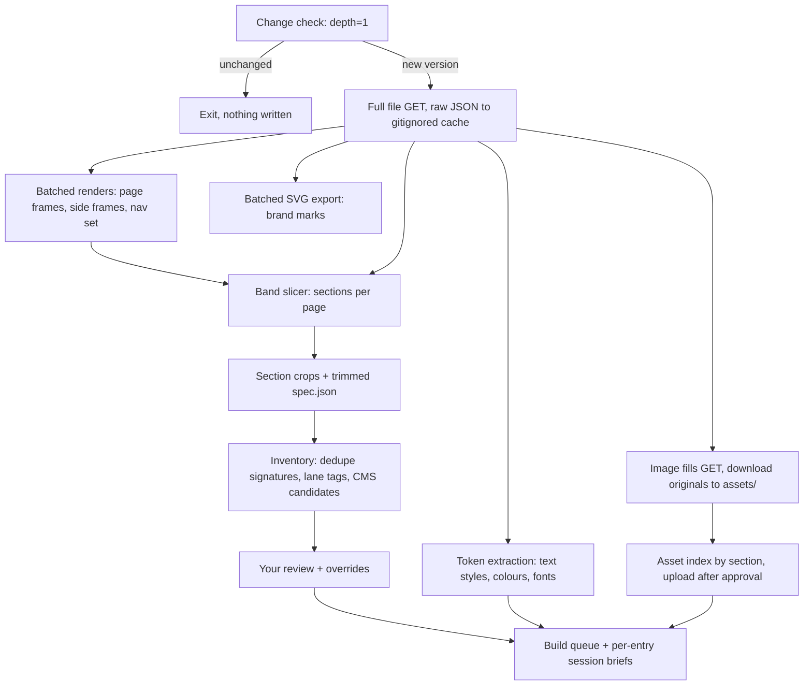

# feat: Snapshot the Guild Figma file locally and drive section builds from it

## Goal Capsule

- **Objective:** Pull the GUILD-WEB-NEW Figma file once over REST, commit a section-level snapshot (renders, crops, trimmed specs, tokens, brand SVGs, asset index), and switch the native build skill to read that snapshot, so later sessions build The Guild Hotel site section by section without touching Figma.
- **Authority:** User instructions in chat, then `CLAUDE.md` (class naming, semantic wrappers, approval before any Webflow mutation), then this plan. `docs/reference/component-patterns.md` governs build structure.
- **Execution profile:** Local Node scripts plus one supervised real snapshot run. Figma REST quota is scarce and can lock for days, so every real Figma call is serial, logged, and counted.
- **Stop conditions:** Stop and report on any Figma 429 with a long `retry-after`, any 403/404 from Figma, or any step that would write to Webflow (asset upload, CMS, styles) without an explicit yes in chat.
- **Tail ownership:** This plan ends with the snapshot committed, the inventory reviewed, and the build queue ready. Building pages is follow-up work, one session per queue entry.

---

## Product Contract

### Summary

Build a one-shot Figma snapshot tool and an offline section inventory for The Guild Hotel, then rewire `build-component` to use the snapshot as its design source. Navbar, modals and sliders are tagged as manual; everything else becomes an agent-buildable queue entry.

### Problem Frame

The Figma MCP is rate limited to a handful of calls, and the Figma REST quota on our plan tiers has locked a file for 4.6 days before (RacketPro, see `~/granite/knowledge/figma-api.md`). The Guild file holds 25 desktop page designs on one canvas, each up to 25,000px tall, so building from live Figma would burn the quota within the first page.

The file is also hard to consume directly. A probe on 2026-10-19 showed every page is a flat 1600px frame of absolutely positioned groups and rectangles, with no auto layout and no named section frames. There are no mobile frames. Animation intent lives in side "Animation" sections holding a screen recording and a sentence of notes. Several pages are clones (four dining venue pages, Legal and Corporate, Happenings and Blog collection and detail pages), which signals CMS templates.

### Requirements

**Snapshot capture**

- R1. One run captures the whole file: node tree, renders of every page frame and side frame, all image fills, and brand marks as SVG.
- R2. The run stays within a declared call budget (target: 8 or fewer rate-limited calls) and records every Figma call it made.
- R3. Re-running when the file has not changed costs one cheap call and writes nothing.
- R4. The run never retries into a long rate-limit window; it stops and reports instead.

**Section snapshot**

- R5. Every page is sliced into ordered sections, each with a reference PNG crop and a trimmed spec (visible text with type style, colours, image references, relative geometry).
- R6. Hidden layers never appear in specs.
- R7. Animation notes are attached to the page and, where possible, the section they describe.

**Inventory and routing**

- R8. Repeated sections across pages are grouped as shared component candidates, and cloned pages are flagged as CMS template candidates.
- R9. Each section carries a lane tag: agent-built, or manual (navbar, modals and overlays, sliders and carousels), and you can override any tag.
- R10. You review the inventory once before any build starts.

**Build enablement**

- R11. `build-component` reads design data from the snapshot by default and calls Figma only as a declared fallback.
- R12. Design tokens (type styles, colours, fonts) are extracted and mapped onto the existing Relume style guide variables.
- R13. A build queue orders work as shared components first, then pages, with a session brief per entry so builds can run autonomously.
- R14. Image assets are indexed by section usage and uploaded to Webflow only after your approval.

### Scope Boundaries

- Building any page or section in Webflow. The queue enables it; each entry is its own session.
- Animation runtime code. Notes are captured; GSAP modules are written per section at build time.
- Mobile designs. None exist; responsive behaviour is inferred from `docs/reference/breakpoints.md` at build time.
- Navbar, modals and overlays, sliders and carousels are built by you. Their snapshots are still captured as reference.

#### Deferred to Follow-Up Work

- Creating CMS collections. This plan proposes schemas; creation waits for approval in a build session.
- Downloading animation reference videos. The REST API does not serve video fills; you export them from Figma by hand if wanted.
- Ratifying the pending Webflow convention against adding DOM through `element_builder` (`~/granite/knowledge/conventions/pending/webflow.md`). This plan follows the project `CLAUDE.md`, which uses the element builder for the native lane.

---

## Planning Contract

### Key Technical Decisions

- KTD1. Fetch the whole file in one call and slice locally. One full `GET /v1/files/:key` (about 1.2MB at depth 4; full depth is expected to be several MB) replaces per-section node calls, following the "fetch once, cache to disk" rule in `~/granite/knowledge/figma-api.md`.
- KTD2. Render pages, crop sections locally. The REST API cannot render a region, and these pages have no section nodes to render. Each page frame is assigned to a fixed scale tier (2, 1, 0.75, 0.5) as the highest tier that keeps it under a configured render cap (default 25 megapixels, confirmed against Figma docs at implementation), one `/v1/images` call per occupied tier. Pages are cropped into sections with `sharp` (already a dev dependency), and the true pixel scale (decoded render size over the rendered box) is recorded so crops map back to Figma coordinates. Figma also caps render height at 16,384px without an error, which is why the scale is measured, not assumed.
- KTD3. Slice sections by vertical bands. Top-level visible children of a page frame are merged into bands by overlapping or near-touching y ranges, and bands below a minimum height are folded into neighbours. Full-bleed rectangles (900px hero blocks) start a new band. Thresholds live in one config so you can tune them after the review. (session-settled: user-approved, chosen over hand-marking sections in Figma: no designer work needed, with one review pass to correct boundaries)
- KTD4. Commit the snapshot; keep large binaries out. Specs, section crops (WebP), tokens, brand SVGs, the asset index and the raw file JSON (gzipped, `figma/raw/file.json.gz`) are committed under `figma/` so every worktree can see and re-slice them without spending quota. Full-page renders stay in the gitignored `figma/.cache/`, and the run fails if any committed file exceeds 10MB. Original photo fills stay in the gitignored `assets/` folder and reach other sessions as Webflow asset URLs once uploaded. (session-settled: user-directed, chosen over a gitignored local cache: worktree sessions could not see it)
- KTD5. Harden the shared Figma client. `scripts/api/lib/figma-client.cjs` currently retries 429s up to 5 times with exponential backoff and ignores `Retry-After`. It will honour `Retry-After`, abort when the wait exceeds a short threshold, surface the plan-tier headers, and append every request to a call ledger. This also protects `export-assets`.
- KTD6. Change-detect with a depth-1 call. The snapshot stores the file `version` and `lastModified`; a re-run first fetches `?depth=1` and exits if both match.
- KTD7. Native lane, project class naming. Builds use `build-component` with the Client-First-adapted naming and semantic wrapper rules in `CLAUDE.md` and `docs/reference/component-patterns.md`. (session-settled: user-directed, chosen over React code components and a per-section mixed lane: matches the Relume style guide already on the site)
- KTD8. Manual lanes: navbar, modals and overlays, sliders and carousels. Detection is structural first: in each page SECTION, the 1600px-wide frame of 3000px or more is the page; any other 1600px frame under 1000px tall (for example `Legal`, `All Rooms`, `window-1`, `*-Overlay`, `ARTS-MODAL`) is an overlay that defaults to manual. Names match case-insensitively, nav component instances inside agent sections are emitted as manual overlays (bbox only), and unmatched side frames default to "needs lane decision". A committed overrides file holds corrections. (session-settled: user-directed, chosen over also handing off footer and forms)
- KTD9. Section naming by vision, inside an agent session. Auto slugs come from the first heading text in each band; a Claude session reviews crops and proposes component names. No paid Anthropic API run is needed.
- KTD10. Webflow image placement may stay manual. Pending conventions record that REST-uploaded assets can be invisible to the Webflow MCP asset tools. The build brief lists image placement as a manual Designer step unless a build session proves otherwise. (session-settled: user-approved, chosen over promising fully autonomous image placement)

### High-Level Technical Design



Network work (top row) runs once and is the only part that touches Figma. Everything from the slicer down is local and re-runnable for free, so threshold tuning and inventory corrections never spend quota.

Planned Figma call budget for one full run:

| Call | Endpoint tier | Count |
|---|---|---|
| Change check (`depth=1`) | Tier 1 | 1 |
| Full file | Tier 1 | 1 |
| Image fills | Tier 2 | 1 |
| Page and side frame renders (batched by scale) | Tier 1 | 2 to 4 |
| Brand SVG export | Tier 1 | 1 |
| **Total** | | **6 to 8** |

### Output Structure

```text
figma/
  README.md                      how to read and refresh the snapshot
  snapshot.json                  file key, version, lastModified, render scales, call ledger summary
  tokens.json                    text styles, colours, fonts, Relume variable mapping
  inventory.json                 every section: page, order, bbox, signature, lane, cluster, CMS flag
  inventory.overrides.json       your manual corrections (lane, merge, split, rename)
  assets.json                    imageRef -> sections using it, dimensions, local file, Webflow id once uploaded
  brand/*.svg                    building, guild logo, stamp, tribute, bonvoy, zuma, menu, day/night
  vectors/*.svg, index.json      every distinct vector-only shape in the pages (icons, arrows, outlines, frame shapes)
  review/vision-*.json           vision pass: layout name, kind, slider flag, boundary notes
  slicer.config.json, slicer.overrides.json  banding rules and per-page split/merge corrections
  animations/<page>.md           notes text and still frame per animation reference
  pages/<page-slug>/
    page.png                     full render at recorded scale
    page.json                    trimmed visible node tree
    sections/<NN>-<slug>/
      section.png                crop
      spec.json                  texts + styles, colours, image refs, relative geometry, notes
  .cache/                        gitignored raw API responses
docs/figma/
  inventory.md                   human-readable review table
  build-queue.md                 ordered entries with lane, dependencies, brief link
  cms-proposal.md                proposed collections and fields from cloned pages
  briefs/<entry>.md              session brief per queue entry
```

### Assumptions

- The token holder has a Full or Dev seat. Two probe calls returned 200, but the plan-tier header was absent, so the monthly View/Collab limit cannot be ruled out. KTD5 and R4 bound the damage either way.
- Figma image-fill URLs are short-lived, so originals are downloaded in the same run.

### Sources and Research

- `~/granite/knowledge/figma-api.md`: quota lockout history, the fetch-once rule, the `visible != false` filter, `jq` recipes.
- `~/granite/knowledge/conventions/pending/webflow.md`: REST-uploaded assets invisible to the MCP, the 4MB upload cap, the element builder caution.
- `scripts/api/figma/export-assets.js` and `scripts/api/lib/manifest.cjs`: the existing fill-download and manifest pattern to reuse.
- `docs/reference/figma-access.md`: pre-flight check and MCP limits.
- Probe of file `7KV5sqOiFIoei8gxhptDOU` on 2026-10-19: one canvas page (`219:738`), 25 Figma SECTION containers holding 24 page frames, frames 1600px wide, 11 named styles, zero published components, nav `COMPONENT_SET` `236:8312`, brand frame `2154:2273`.

---

## Implementation Units

### U1. Harden the Figma client

- **Goal:** Make every Figma REST call quota-safe and auditable.
- **Requirements:** R2, R4
- **Dependencies:** none
- **Files:** `scripts/api/lib/figma-client.cjs`, `tests/figma/figma-client.test.mjs`
- **Approach:** Honour `Retry-After`; abort with a clear error naming the wait in hours when it exceeds a threshold of about 60 seconds; log `x-figma-plan-tier` and `x-figma-rate-limit-type` when present; add an optional ledger path that appends one line per request (time, endpoint, status, bytes). Add `getFile` and `getFileMeta` (depth 1) methods. Keep existing method signatures so `export-assets.js` still works.
- **Patterns to follow:** existing `_request` host guard in `figma-client.cjs`.
- **Test scenarios:**
  - A 429 with `retry-after: 396863` throws immediately without retrying, and the message reports about 110 hours.
  - A 429 with `retry-after: 2` waits and retries once, then succeeds.
  - A ledger path receives one entry per request, including failed ones.
  - A non-Figma URL is still refused.
- **Verification:** Tests pass with a mocked `fetch`; `export-assets.js` still runs its usage message unchanged.

### U2. Snapshot fetcher

- **Goal:** One command pulls everything network-bound into the cache and `assets/`.
- **Requirements:** R1, R2, R3
- **Dependencies:** U1
- **Files:** `scripts/api/figma/snapshot.mjs`, `figma/snapshot.json`, `figma/README.md`, `.gitignore`, `package.json` (`figma:snapshot` script), `tests/figma/snapshot.test.mjs`
- **Approach:** Read the file key from `FIGMA_FILE_KEY` (added to `.env.example`) or an argument. Run the depth-1 change check, then the full file GET, image fills, batched page renders (page frames, overlay and modal frames, nav component set, animation sections) and the brand SVG export, serially with a short delay between calls. Discover frames structurally per KTD8 (24 page frames; NAV-ELEMENTS and brand frame `2154:2273` special-cased). Bucket frames into scale tiers per KTD2 and download every render URL immediately after each response. A null render URL is a per-frame failure recorded in `snapshot.json`, never auto-retried; `--only <frameId>` re-renders one frame for one extra call. Each network step writes its response plus a completion marker to `figma/.cache/` keyed by file version and is skipped on re-run; `snapshot.json` (version, lastModified) is written only after every step succeeds, so an interrupted run resumes with only the remaining calls. Write the gzipped raw file JSON to `figma/raw/`, full renders to `figma/.cache/renders/`, SVGs to `figma/brand/`, and fill originals to `assets/images/` through the existing manifest helpers (the section-usage index for R14 is built in U7). Print the call count against the budget. Add a `--dry-run` flag that lists planned calls without making them, and a `test:figma` script wired into `factory:verify`.
- **Execution note:** Prove it with `--dry-run` and the tests first; the single real run happens under supervision and is the only one this plan needs.
- **Test scenarios:**
  - When the stored version matches the depth-1 response, the run makes one call and writes nothing.
  - `--dry-run` lists the planned calls and makes zero network requests.
  - The 24 real page frame sizes plus side frames resolve to 4 or fewer scale tiers; a 1600 x 900 frame gets tier 2.
  - Structural discovery finds 24 page frames and tags `Legal`, `All Rooms`, `window-1` as side frames.
  - A fill URL or render URL missing from a response is reported, and the run continues.
  - A run aborted by a long 429 after the full-file fetch resumes without re-fetching it and without the change check reporting unchanged.
- **Verification:** A real run finishes within 8 rate-limited calls, `figma/snapshot.json` lists them, and 24 page renders plus side frames exist, with no committed file over 10MB.

### U3. Section slicer and specs

- **Goal:** Turn cached JSON plus page renders into ordered section folders with crops and specs.
- **Requirements:** R5, R6, R7
- **Dependencies:** U2
- **Files:** `scripts/api/figma/slice-sections.mjs`, `scripts/api/figma/lib/bands.mjs`, `scripts/api/figma/lib/spec.mjs`, `figma/slicer.config.json`, `tests/figma/bands.test.mjs`, `tests/figma/spec.test.mjs`, `tests/figma/fixtures/home-frame.json`
- **Approach:** Band the visible top-level children per KTD3 using defaults in `slicer.config.json` (merge gap, minimum band height, `maxBandHeight`, full-bleed rule), splitting runs of repeated equal-height siblings into separate bands. Drop nodes outside the frame bounds. Read the committed `figma/raw/file.json.gz`, so slicing works from a clean checkout. Crop each band from the page render with `sharp` using the recorded scale, and write `spec.json` with visible text (characters, font family, size, weight, line height, letter spacing, case, named style), solid fills as hex, image fill refs, and geometry relative to the band, and nav instances as manual overlays (bbox only). Write crops as WebP. Attach animation notes by matching the animation section's position or name to its page. Fully local; no network.
- **Patterns to follow:** `walkNode` and the `visible === false` skip in `scripts/api/figma/export-assets.js`.
- **Test scenarios:** (fixture is a trimmed copy of the real Home frame `433:559`)
  - The Home fixture yields a hero band ending near 900px, with the nav instance recorded as a manual overlay rather than as texts.
  - The five 988px Home cards 36px apart become five bands, not one.
  - Overlapping groups merge into one band; a 40px gap does not split a section, a 300px gap does.
  - The hidden `Tribute 1` rectangle never appears in any spec.
  - A text node's named style (`H2-CAPS`) and raw values both appear in the spec.
  - Re-running produces byte-identical output.
- **Verification:** Every page folder has ordered sections, and a spot check of five crops against `page.png` shows clean boundaries.

### U4. Tokens extraction and Relume mapping

- **Goal:** Give builds one shared token spec mapped onto the existing style guide.
- **Requirements:** R12
- **Dependencies:** U2
- **Files:** `scripts/api/figma/extract-tokens.mjs`, `figma/tokens.json`, `docs/reference/style-guide.md`, `tests/figma/tokens.test.mjs`
- **Approach:** Collect the 11 named styles plus the distinct text styles and fill colours actually used in visible nodes, with usage counts. Map them to the Relume variables and `heading-style-*` / `text-size-*` classes, and mark values with no equivalent as justified overrides. List fonts (for example Sackers Heavy Gothic) and flag any that must be uploaded to Webflow by hand. Syncing variables into Webflow stays in the existing token sync step and needs your approval.
- **Test scenarios:**
  - Given the fixture, every named style resolves to exactly one mapping entry.
  - Colours that differ only by alpha are kept distinct; near-duplicate hexes are grouped with a note.
- **Verification:** `figma/tokens.json` covers every style referenced by any `spec.json`.

### U5. Inventory, dedupe and lane tagging

- **Goal:** One reviewable list of every section with its cluster, lane and CMS status.
- **Requirements:** R8, R9, R10
- **Dependencies:** U3
- **Files:** `scripts/api/figma/build-inventory.mjs`, `figma/inventory.json`, `figma/inventory.overrides.json`, `docs/figma/inventory.md`, `docs/figma/cms-proposal.md`, `tests/figma/inventory.test.mjs`
- **Approach:** Compute a structural signature per section (sequence of text roles, where an unstyled text's role is its quantised size, weight and case bucket, image count, column layout from x-positions, height bucket) and cluster matching signatures across pages as shared component candidates. Flag whole-page clones (the four dining venue pages, Legal and Corporate, Happenings and Blog) as CMS templates and draft collection fields from the varying text and images. Tag lanes per KTD8 and apply the overrides file last. A Claude session then views the crops and fills in proposed component names (KTD9). Render `docs/figma/inventory.md` as a table for your review.
- **Test scenarios:**
  - The four dining venue pages produce one CMS template candidate with matching section clusters.
  - The nav component set, `ARTS-MODAL`, `Legal`, and every `*-Overlay` frame (any case) are tagged manual.
  - An override that changes a lane or merges two sections wins over auto-tagging and survives a re-run.
- **Verification:** You approve `docs/figma/inventory.md`, with corrections captured in the overrides file.

### U6. Offline mode for `build-component`

- **Goal:** The native build skill uses the snapshot as its design source.
- **Requirements:** R11
- **Dependencies:** U3, U4, U5
- **Files:** `.claude/skills/build-component/SKILL.md`, `docs/reference/figma-access.md`, `docs/reference/style-inventory.md`, `docs/reference/webflow-ids.md`, `CLAUDE.md`
- **Approach:** Replace the skill's Figma MCP read phase with: look up the section in `figma/inventory.json` by page and section slug, then read its `spec.json`, `section.webp`, `tokens.json` and `figma/assets.json`; call the Figma MCP only when a spec field is missing, and log that call. Use `section.webp` as the vision-compare reference. Reset `style-inventory.md`, which still describes a previous project, to an instruction to regenerate it from `get_styles` on first build. Cache the site ID and the five current page IDs in `webflow-ids.md`. Add a one-line pointer to `figma/README.md` in `CLAUDE.md`.
- **Test expectation:** none, skill and docs only. Proven by the first queue entry in follow-up work.
- **Verification:** The skill text names no Figma MCP call on its default path.

### U7. Build queue and session briefs

- **Goal:** A ready-to-run, ordered queue that lets build sessions proceed with minimal input from you.
- **Requirements:** R13, R14
- **Dependencies:** U5, U6
- **Files:** `scripts/api/figma/build-queue.mjs`, `docs/figma/build-queue.md`, `docs/figma/briefs/`, `figma/assets.json`, `tests/figma/build-queue.test.mjs`
- **Approach:** Order entries as global setup (token sync, font upload, asset upload), then shared component clusters by reuse count, then CMS templates, then remaining pages. Manual-lane entries appear as yours with their reference crop. Each brief names the spec paths, target Webflow page, classes to reuse, assets with Webflow URLs, animation notes, the manual Designer steps (image placement per KTD10), and the subagent line required by your global rules. Asset upload uses `pnpm run upload-assets` after your approval, resizing anything over 4MB on the long edge.
- **Test scenarios:**
  - A shared cluster used on three pages is queued before every page that uses it.
  - Manual-lane sections never get an agent brief.
  - Every brief references files that exist on disk.
- **Verification:** `docs/figma/build-queue.md` covers every inventory section exactly once.

---

## Verification Contract

| Gate | Command or check | Applies to |
|---|---|---|
| Unit tests | `node --test tests/figma/*.test.mjs` | U1 to U5, U7 |
| Factory tests stay green | `pnpm test:factory` | all |
| Typecheck (covers `src/` only) | `pnpm check` | all |
| Dry run makes no calls | `pnpm figma:snapshot --dry-run` | U2 |
| Real run budget | `figma/snapshot.json` ledger shows 8 or fewer rate-limited calls | U2 |
| Visual spot check | five random `section.png` crops compared with `page.png` | U3 |
| Human review | you approve `docs/figma/inventory.md` | U5 |

## Definition of Done

- The real snapshot is committed under `figma/`, and a second run exits after one call.
- Every page has sections with crops and specs, and no hidden layer appears in any spec.
- You have reviewed and approved the inventory and lane tags, with corrections in the overrides file.
- `build-component` defaults to the snapshot, and the build queue plus briefs exist for every agent-lane entry.
- No Webflow write happened without an explicit yes in chat.
- Dead-end code from abandoned slicing or clustering approaches is removed from the diff.

---

## Risks and Dependencies

| Risk | Mitigation |
|---|---|
| Quota lockout mid-run | U1 aborts on long `retry-after`; U2 completion markers resume with only the remaining calls; the dry run is free. |
| Bands split or merge sections wrongly on flat layers | Tunable config, a free local re-run, and the overrides file; the review gate in U5. |
| Render cap downscales tall pages, blurring crops | Recorded scale; tall pages can be re-rendered in two halves by rendering their top-level groups if crops prove too soft. |
| Custom fonts unavailable in Webflow | U4 flags them; uploading fonts is a manual step in the queue. |
| Figma MCP and Webflow MCP not connected in this session | Not needed for U1 to U5; builds need the Webflow MCP, an open Designer and the companion app. |
| Design changes after snapshot | KTD6 change check triggers a full re-fetch; re-slicing is local and free, and the overrides file carries corrections across runs. |
