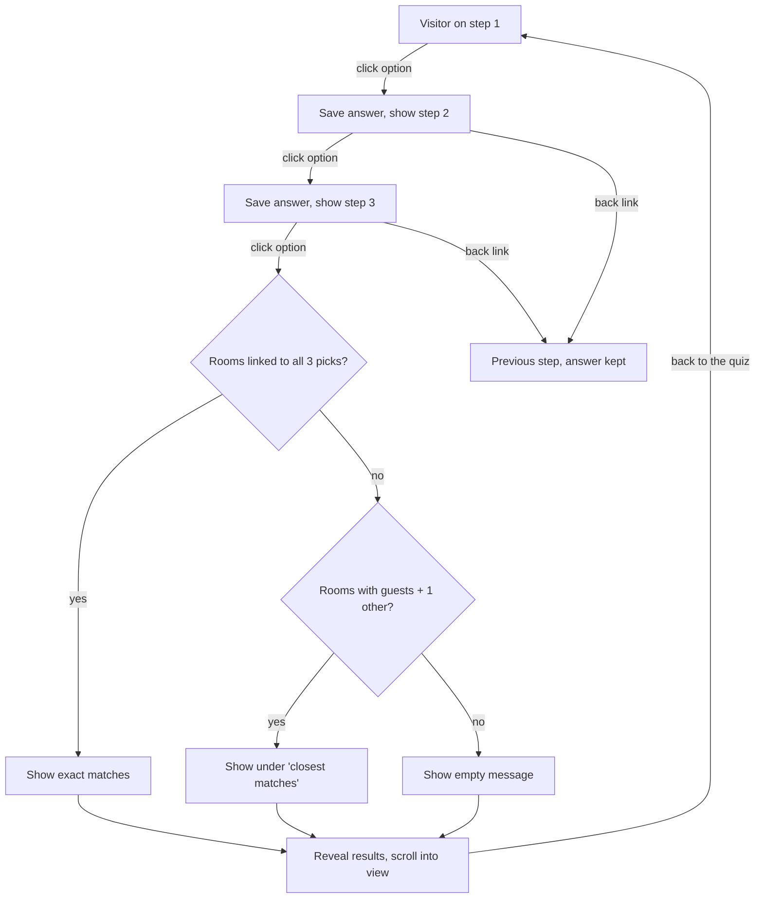

# Rooms Quiz - Plan

## Goal Capsule

- **Objective:** turn the static three-step quiz on `/rooms` into a working multi-step form that ends in CMS-driven room recommendations (feedback F26, punch-list D-quiz).
- **Product authority:** Stephen Anindo.
- **Open blockers:** none. Room tags are placeholders until the client supplies real room features.
- **Stop conditions:** stop and ask before any Webflow Designer or Data API change (repo rule); stop if Finsweet CMS Nest cannot read the room template pages on staging.
- **Execution profile:** Webflow CMS and Designer work through the Webflow MCP (Designer open, bridge app running), plus one new runtime module in this repo.
- **Tail ownership:** release through `webflow-deploy` (changeset, tag, footer URL bump) after the module is verified on staging.

---

## Product Contract

### Summary

The `/rooms` quiz shows one step at a time; picking an option advances to the next step, and after step 3 a hidden recommendations section appears with the rooms that match all three answers.
Quiz options live in their own CMS collection and each room links to the options it fits, so new options are added in the CMS without code.
"See all the rooms" on every step opens the existing all-rooms dialog.

### Problem Frame

The quiz was built in Q033 as three stacked, static `section_rooms-collection-quiz` steps: every step shows at once, option buttons link to `#`, the selected state is a fixed class, and the recommendations grid always shows the same four rooms flagged "show in recommendations". The Rooms collection only knows guest capacity and room vs suite, so nothing in the CMS can answer "which rooms suit a couples getaway with a courtyard view".

### Key Decisions

- **Options are a CMS collection, rooms reference them.** One Quiz Options collection holds every option for all three steps (guest counts included); each option belongs to step 1, 2 or 3 and carries its own image. Each room links to the options it fits. (session-settled: user-directed, chosen over a fixed mapping in code or guest-count-only filtering: options can be created as and when needed without a release.)
- **Exact match first, labelled closest matches as fallback.** A room matches when it is linked to all three picked options. When none match, show rooms that match the guest option plus one other answer under a "closest matches" label. (session-settled: user-directed, chosen over top-4 scoring and over a message-only empty state: exact matches are the promise, but the result should never be a dead end.)
- **Recommendations are hidden until the quiz is finished.** (session-settled: user-directed, chosen over showing default picks first.)
- **Image swaps on hover and focus, click advances.** Hovering or focusing an option crossfades the step's photo to that option's image on all three steps; clicking selects and moves on. This supersedes F40 ("swap on click"), which the feedback-batch-3 session has been told to leave to this work. (session-settled: user-directed, chosen over a Next button, which the Figma does not have.)
- **Back navigation.** Steps 2 and 3 get a back link that keeps earlier answers; "back to the quiz" on the results restarts at step 1 with answers cleared. (session-settled: user-approved.)
- **Placeholder tags.** Rooms are tagged at random for now, with extra rooms added if needed, so most answer combinations return at least one exact match. The client corrects tags in the CMS later. (session-settled: user-directed.)

### Requirements

**Step flow**
- R1. Only the current step is visible; on load that is step 1.
- R2. Each step shows its counter (01 / 03, 02 / 03, 03 / 03) and question as in Figma.
- R3. Clicking an option records it as that step's answer, shows it as selected, and advances to the next step.
- R4. Steps 2 and 3 show a back link that returns to the previous step with its earlier answer still selected.
- R5. Keyboard users can operate every option, back link and see-all link, and focus moves to the new step's question when the step changes.

**Options and images**
- R6. The options on each step come from the Quiz Options collection, filtered to that step and ordered by a sort field.
- R7. Each option has its own image; hovering or focusing an option crossfades the step's photo to it, and leaving the options restores the step's default photo.

**Recommendations**
- R8. The recommendations section is hidden until step 3 is answered, then revealed and brought into view.
- R9. It shows every room linked to all three picked options.
- R10. When no room matches all three, it shows rooms linked to the guest option and at least one other picked option, under a "closest matches" line.
- R11. When even the fallback is empty, it shows a short message with the see-all-rooms and back-to-the-quiz actions.
- R12. Each result card links to that room's detail page, as the current grid cards do.
- R13. "Back to the quiz" on the results hides the recommendations, clears all answers and returns to step 1.

**See all rooms**
- R14. "See all the rooms" on every step and on the results opens the existing all-rooms dialog.
- R15. The dialog's "back to the quiz" closes it and returns the visitor to the quiz in the state they left it.

**Content**
- R16. The Quiz Options collection is seeded with the Figma options: Just me, Two guests, 3-4 guests, 5+ guests; Couples getaway, Business trip, Family & friends, Celebration, Extended stay; Spaciousness, Elevator proximity, Courtyard view, Street view, Quiet.
- R17. Every room is linked to options so that most of the 100 answer combinations have an exact match; add placeholder rooms if the current 10 cannot cover enough.

### Key Flows

- F1. Complete the quiz
  - **Trigger:** visitor reaches the quiz on `/rooms`.
  - **Steps:** pick guests, pick stay type, pick what matters; recommendations appear below and scroll into view.
  - **Outcome:** exact matches, or labelled closest matches.
  - **Covered by:** R1, R3, R8, R9, R10
- F2. Change an answer mid-quiz
  - **Trigger:** visitor on step 2 or 3 clicks back.
  - **Steps:** previous step shows with its answer selected; a new pick replaces it and advances.
  - **Covered by:** R4
- F3. Browse everything instead
  - **Trigger:** visitor clicks "See all the rooms" on any step.
  - **Steps:** all-rooms dialog opens; "back to the quiz" closes it.
  - **Outcome:** visitor is back on the step they left.
  - **Covered by:** R14, R15

### Acceptance Examples

- AE1. **Covers R9.** Given rooms A and B are linked to "Two guests", "Couples getaway" and "Quiet", when a visitor picks those three, then A and B show and no "closest matches" line appears.
- AE2. **Covers R10.** Given no room is linked to "5+ guests", "Business trip" and "Courtyard view", but room C is linked to "5+ guests" and "Business trip", when a visitor picks those three, then C shows under "closest matches".
- AE3. **Covers R4, R13.** Given a visitor on step 3 clicks back, then step 2 shows with their pick selected; given a visitor on the results clicks "back to the quiz", then step 1 shows with nothing selected and the results are hidden.

### Scope Boundaries

- Real room features and stay suitability: the client supplies them later; tags are placeholders.
- Remembering answers across page loads or sharing results by URL.
- Analytics on quiz answers.
- Quiz option text size (Figma H5-CAPS 20px vs the current 16px) stays a separate punch-list item.

### Dependencies / Assumptions

- The all-rooms dialog (`Room List Hover Preview`, DOM id `all-rooms`) and its "back to the quiz" link already exist; the link currently only closes the dialog.
- On 2026-10-27, at Stephen's request, the feedback-batch-3 session (not yet published) changed `.rooms-collection-quiz_option` from grid to flex column and added the `is-fill` combo (flex: 1 1 auto) to all 14 quiz buttons (`button is-chamfer is-outline-light is-fill`, `button is-chamfer is-text-burgundy is-fill`). Any rebuilt option markup and any selected-state class toggle must keep `is-fill`.
- Each room's linked options reach `/rooms` through Finsweet CMS Nest, which loads each room's detail page and copies its option list into the room's result card (see Planning Contract).

### Sources / Research

- `docs/figma/feedback/2026-10-26.md` (F25, F26, F27) and feedback batch 3 F40 on branch `claude/feedback-batch-3`.
- `docs/figma/briefs/Q033-page-rooms-collection.md`: quiz steps and recommendations heading.
- `docs/reference/webflow-ids.md` "F27 Rooms collection, template and grid": Rooms collection fields, items, grid and all-rooms dialog ids.
- `docs/reference/runtime-modules.md` "hoverImageSwap": current step 1 image-swap contract.
- `docs/figma/punch-list.md` D-quiz and `docs/figma/follow-ups.md` Q033 quiz items.

Product Contract preservation: unchanged.

---

## Planning Contract

### Key Technical Decisions

- KTD1. **Room options reach the page through Finsweet CMS Nest v1.** Webflow shows at most 5 linked items in a nested list and a room can link to up to 14 options, so each result card carries an empty nest target and CMS Nest fills it from the room's detail page, where the option list is top-level. (session-settled: user-directed, chosen over a sync script that copies tags into a text field and over typed tags: always matches the CMS with no extra step for editors.) Use v1 (`@finsweet/attributes-cmsnest@1`) to match the v1 CMS Filter already documented in `docs/reference/finsweet-cms-filter.md`.
- KTD2. **One quiz root, three step panels.** The three `section_rooms-collection-quiz` sections collapse into one section holding three step panels, so the visible step swaps in place without the page jumping between sections. The class family stays `rooms-collection-quiz` (one family per component rule); the current panel gets `is-active`, all others are hidden by the base class so only step 1 shows if the bundle fails.
- KTD3. **Options and images are Collection Lists of Quiz Options filtered by step.** Each panel has one list for its option buttons and one list for its stacked photos inside the figure, both bound to the same option slug. Each figure also holds one static resting photo keyed `default` ahead of the option images, which carry the `is-swap` combo so only the resting photo shows without JS. The existing `hoverImageSwap` runs per panel unchanged (it already supports several roots), which delivers R7 and closes F40 without new swap code.
- KTD4. **A new `roomsQuiz` module owns state and matching.** It holds the three answers, switches panels, sets the selected option (`is-active` plus `aria-pressed`, keeping `is-fill` and the variant classes untouched), and filters the result cards. It waits for CMS Nest to finish through `window.fsAttributes.push(['cmsnest', ...])` before reading a card's options, and treats a card whose nest never filled as unmatched. If CMS Nest has not reported after 8 seconds, it shows a short loading line meanwhile, then evaluates whatever cards are filled. Option, back and back-to-quiz handlers call `preventDefault()`, because the option links carry `href="#"`.
- KTD5. **Results list is every room, filtered on the client.** The existing grid list drops its "show in recommendations" filter and limit of 4 and lists all rooms by sort order; the module hides non-matching cards with the template `hide` class, as `galleryFilter` does. The `show-in-recommendations-grid` field stays in the CMS, unused.
- KTD6. **Card links get a real Designer href.** CMS Nest follows each card's link to the room page, so the card link is set in the Designer to the current Rooms item instead of relying on `cmsItemLinks` rewriting `#` at runtime. `cmsItemLinks` stays as a harmless fallback.
- KTD7. **"See all the rooms" uses the existing modal contract.** Every see-all link carries `data-modal-open="all-rooms"`. The dialog's "back to the quiz" link (`href="#rooms-quiz"`) already closes the dialog, scrolls to the quiz section and focuses it; the quiz module's state is untouched, so the visitor sees the step they left (R15) with no new code. The merged quiz section keeps `id="rooms-quiz"`.
- KTD8. **After step 3 the quiz stays on step 3.** The panel keeps the visitor's pick visible above the revealed results; the results grid keeps its two-column layout and wraps for any count.

### High-Level Technical Design

Data path: Quiz Options collection, referenced by the Rooms multi-reference field, rendered top-level on each room's detail page, copied into `/rooms` result cards by CMS Nest, read by `roomsQuiz` as option slugs.

### Assumptions

- Webflow's nested-list limit was 5 items per nested list; a secondary source suggests it may now be higher, which U2 checks before building.
- The `/rooms` page stays well under Webflow's 20 Collection Lists per page (it will have 7: three option lists, three image lists, one results list).
- Loading 10 to 14 room pages in the background is acceptable; CMS Nest starts on page load and the visitor needs three clicks before results matter.

### Sources & Research

- `src/utils/hoverImageSwap.ts` and its spec `tests/visual/hover-image-swap.spec.ts`: per-root swap contract reused by KTD3.
- `src/utils/galleryFilter.ts`: data-attribute filtering with the `hide` class, the pattern for KTD5.
- `src/utils/filterActiveState.ts`: existing `window.fsAttributes` callback usage for KTD4; types in `src/types/finsweet.d.ts`.
- `src/utils/smoothScroll.ts`: engine `scrollTo(target)` for revealing results.
- `docs/reference/modal-setup.md`: `data-modal-open` contract for KTD7.
- Webflow nested list limits: [Dynamic content limitations](https://help.webflow.com/lesson/dynamic-content-limitations).

---

## Implementation Units

### U1. Quiz Options collection and room tags

- **Goal:** the CMS can answer which rooms fit each option.
- **Requirements:** R16, R17; KTD1.
- **Dependencies:** none.
- **Files:** `scripts/api/webflow/seed-rooms-quiz.mjs` (new, dry-run by default), `docs/reference/webflow-ids.md`.
- **Approach:** create collection "🧭 Quiz Options" (emoji, client-facing name per the CMS label convention) with name, slug, step (Option: 1, 2, 3), sort order, image, and alt text. Add a multi-reference field "Quiz options" to Rooms. Seed the 14 options with the existing step 1 photos and stand-in photos for steps 2 and 3. Tag rooms with one guest range that fits `max-guests`, two or three stay types and two or three features, spreading tags so new rooms fill uncovered combinations rather than purely at random, then compute exact-match coverage of the 100 combinations; add published placeholder rooms until coverage, computed over published rooms only, is at least 70% (they appear in results and have detail pages; the all-rooms dialog is static, so they stay out of it). Expect roughly 20 rooms in total; placeholder room names start with "Placeholder" and are listed in `docs/reference/webflow-ids.md` so they can be removed before the client launch. Present the full write list for approval before running without `--dry-run`. Cache every new id in `docs/reference/webflow-ids.md`.
- **Patterns to follow:** F27 Rooms collection setup in `docs/reference/webflow-ids.md`; destructive-safe script defaults from the global rules.
- **Test scenarios:**
  - Dry run prints every option and room tag write and changes nothing.
  - Coverage report lists the combinations with no exact match and the overall percentage.
  - Re-running the seed does not duplicate options (match by slug).
- **Verification:** the CMS shows 14 options and every room links to at least one option per step; coverage is at least 70%.

### U2. Room template exposes its options

- **Goal:** each room page renders its linked options as a top-level list CMS Nest can copy.
- **Requirements:** R9, R10; KTD1.
- **Dependencies:** U1.
- **Files:** `docs/reference/webflow-ids.md`.
- **Approach:** first check in the Designer whether a plain nested Collection List inside a Rooms list item now shows all of a room's options (Webflow's help page may have raised the 5-item cap). If it does, ask Stephen before replacing CMS Nest with a native nested list. Otherwise, on "🛏️ Rooms Template", add a visually hidden Collection List bound to the current room's "Quiz options", each item carrying `data-rooms-quiz-tag` bound to the option slug. Add the CMS Nest v1 script to `/rooms` page custom code only, and load no Finsweet v2 script on that page. CMS Nest v1 attributes, all sharing `fs-cmsnest-collection="room-quiz-options"`:

  | Attribute | On |
  |---|---|
  | `fs-cmsnest-element="list"` | the results Rooms Collection List on `/rooms` |
  | `fs-cmsnest-element="nest-target"` | an empty div inside each result card |
  | `fs-cmsnest-element="template-reference"` | the Quiz options list on the Rooms Template |

  The card's item link must wrap the card or be a hidden direct child of the item. The template page must be published to staging before U4's staging check. CMS Nest caches room pages until the next site publish, so tag edits show after a republish.
- **Test expectation:** none, Designer-only markup; proven by U4's staging check.
- **Verification:** a room page's HTML contains one `data-rooms-quiz-tag` element per linked option, and nothing visible changes on the page.

### U3. Rebuild the quiz and results markup on /rooms

- **Goal:** the Designer structure the module drives.
- **Requirements:** R1, R2, R4, R6, R7, R8, R11, R12, R14, R15; F3; KTD2, KTD3, KTD5, KTD6, KTD7.
- **Dependencies:** U1, U2.
- **Files:** `docs/reference/webflow-ids.md`, `docs/reference/runtime-modules.md`.
- **Approach:** present the element and class plan for approval, then build one `section_rooms-collection-quiz` with `data-rooms-quiz` and `id="rooms-quiz"`, holding three panels (`data-rooms-quiz-step="1|2|3"`), each with counter, question header, option list (button `data-rooms-quiz-option` bound to slug, keeping `button is-chamfer ... is-fill`), back link on steps 2 and 3 (`data-rooms-quiz-back`), see-all link (`data-modal-open="all-rooms"`), and a figure with the step's image list. For `hoverImageSwap`, the panel carries `data-hover-swap`, its option list `data-hover-swap-list`, each option `data-hover-swap-trigger` and each stacked image `data-hover-swap-media`, both bound to the option slug, with the step's resting photo keyed `default`. Results section gets `data-rooms-quiz-results`, hidden by default, with "closest matches" line (`data-rooms-quiz-closest`), empty message (`data-rooms-quiz-empty`), the back-to-quiz and see-all links, and the room list changed per KTD5; each card has a CMS Nest target and a real item link. Delete the two now-empty step sections only after the new one is approved and built.
- **Test expectation:** none, Designer-only; the fixture in U4 mirrors this contract.
- **Verification:** with the bundle blocked, step 1 shows alone and results are hidden; the Designer navigator shows one quiz section inside `main.main-wrapper`.

### U4. roomsQuiz runtime module

- **Goal:** step flow, selection, matching and results.
- **Requirements:** R1 to R5, R8 to R13; F1, F2; AE1, AE2, AE3; KTD4, KTD5.
- **Dependencies:** none to write it against the fixture; U3 to verify on staging.
- **Files:** `src/utils/roomsQuiz.ts` (new), `src/index.ts`, `tests/visual/fixtures/rooms-quiz.html`, `tests/visual/fixtures/rooms-quiz.ts`, `tests/visual/rooms-quiz.spec.ts`.
- **Approach:** guard on `[data-rooms-quiz]`. Clicking an option stores the answer, marks it selected, shows the next panel and moves focus to its question. On step 3, wait for CMS Nest (or an already-finished signal), compute exact matches, else closest matches (guest option plus at least one other), else empty; toggle `hide` on cards, toggle the closest line and empty message, show the results and scroll to them with the engine's `scrollTo`, then `ScrollTrigger.refresh(true)`. Back link shows the previous panel with its answer still selected. Back-to-quiz clears answers and selections, hides results and scrolls to the quiz. Register in `src/index.ts` after `modals()` and `hoverImageSwap()`. The fixture stubs nested option elements directly so tests do not depend on Finsweet.
- **Execution note:** write the fixture and failing specs first, mirroring `hover-image-swap.spec.ts`.
- **Test scenarios:**
  - Load shows step 1 only; steps 2 and 3 and results are hidden.
  - Clicking "Two guests" marks it pressed, shows step 2, and focuses the step 2 question.
  - Covers AE1. Picking an option set linked to two rooms shows exactly those two cards and no closest line.
  - Covers AE2. Picking a set with no exact match but one guest-plus-one room shows that room under the closest line.
  - A set with neither shows the empty message and no cards.
  - Covers AE3. Back on step 3 shows step 2 with its answer pressed; a new pick replaces it.
  - Covers AE3. Back to the quiz from results shows step 1 with no option pressed and hides results.
  - Selected option keeps `is-fill` and its variant classes.
  - A card with no nested options is never shown as an exact match.
  - Keyboard: Enter on a focused option advances the step.
  - An option click leaves `scrollY` unchanged (no `#` jump).
  - With the CMS Nest callback withheld, step 3 shows the loading line, then after the timeout the empty message with see-all and back actions.
  - Back after a hovered pick shows the previous step's resting photo, not the stale hovered one.
  - After step 3, the step 3 panel stays visible with its pick pressed while results show below.
- **Verification:** all specs pass; on staging, F1 to F3 work end to end with real CMS data.

### U5. Docs, feedback status and release

- **Goal:** the work is findable and live.
- **Requirements:** all; closes F26 and F40.
- **Dependencies:** U1 to U4.
- **Files:** `docs/reference/runtime-modules.md`, `docs/reference/webflow-ids.md`, `docs/figma/feedback/2026-10-26.md`, `docs/figma/punch-list.md`, `docs/figma/follow-ups.md`, `.changeset/` (new changeset).
- **Approach:** add a `roomsQuiz` section with the attribute table, the CMS Nest dependency and the no-JS fallback; note `hoverImageSwap` now runs on all three panels; tick F26, D-quiz and the Q033 quiz follow-ups; release with `webflow-deploy`.
- **Test expectation:** none, documentation and release.
- **Verification:** the jsDelivr URL for the new tag serves the module, and the footer points at it.

---

## Verification Contract

| Gate | Command or check | Applies to |
|---|---|---|
| Typecheck | `pnpm check` | U4 |
| Build | `pnpm build` | U4, U5 |
| Module specs | `npx playwright test tests/visual/rooms-quiz.spec.ts tests/visual/hover-image-swap.spec.ts` | U4 |
| Seed dry run | `node scripts/api/webflow/seed-rooms-quiz.mjs` (no flags) reviewed before the real run | U1 |
| Staging walk-through | publish to staging, run F1 to F3 and AE1 to AE3 at 1440px and 375px | U2, U3, U4 |

---

## Definition of Done

- Every unit's Verification holds and every gate above passes.
- Webflow changes were approved before they were made, and all new ids are in `docs/reference/webflow-ids.md`.
- The quiz works on staging with real CMS data at desktop and mobile widths, and the footer URL serves the released module.
- No abandoned experimental code, unused attributes or leftover quiz sections remain.
